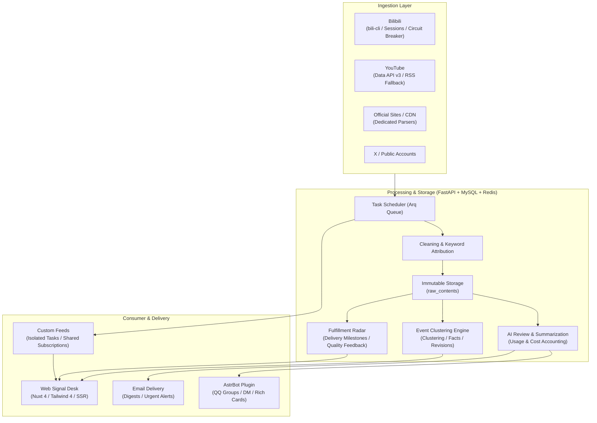

<div align="center">


# AniSignal

**Let what matters find you.**

A self-hosted cross-platform signal desk and event tracking radar. Consolidate public updates across platforms, preserve event provenance with revision evidence, and deliver straight to what you follow.

<p>


<a href="https://github.com/tianyin231/AniSignal/actions/workflows/ci.yml"></a>

</p>

[Live Demo](https://anisignal.xyz/) · [Interactive Tour](https://anisignal.xyz/intro) · [Project & Updates](https://anisignal.xyz/project) · [Quick Start](#quick-start) · [Deployment](docs/deployment.md) · [Issues](https://github.com/tianyin231/AniSignal/issues)

[简体中文](README.md) · **English**

</div>

---

Following game updates, product fulfillment, or frontier developments often means continuously checking multiple official sites, social accounts, and community boards. Repetitive noise, fragmented posts, and algorithm feeds bury the signals that actually matter.

AniSignal is a lightweight, rigorous **self-hosted information hub**. It periodically sweeps public sources you care about, cleanses and categorizes noisy inputs, merges fragmented posts into **structured, traceable events**, tracks product delivery lifecycles, runs independent custom monitoring tasks, and delivers via daily morning email and the AstrBot bot companion.

## Interface Preview

<a href="https://anisignal.xyz/intro"></a>

Designed under the "Signal Desk" design system with dark mode and dynamic backdrop glassmorphism. [Try the Interactive Tour](https://anisignal.xyz/intro) · [Browse the Live Demo](https://anisignal.xyz/)

## Key Capabilities

| Module | Purpose and Value |
| :--- | :--- |
| **Multi-source Ingestion** | Ingestion from Bilibili (`bili` CLI wrapper, dynamic feeds, video search, circuit breakers), YouTube (Data API v3 with RSS fallback), X (low-frequency public sweeping), official game portals and CDNs. Integrated proxy pool and health monitoring. |
| **Community Partitions** | Native support for Wuthering Waves, Azur Lane, Honkai: Star Rail, Arknights, Genshin Impact, Endfield, NIKKE, and AI News. Supports global cross-partition aggregation alongside isolated game channels. |
| **Immutable Events Engine** | Raw inputs are immutable and versioned; automatic clustering over 72-hour windows; LLM extraction of structured facts and revision history; preserved human override locking. |
| **Product Fulfillment Loop** | Automatic discovery of official merchandise from announcements; windowed tracking across review samples, first customer delivery, and quality feedback. |
| **Personal & Custom Feeds** | Keyword attribution streams over existing collections, plus independent Bilibili UID/keyword monitoring queues with public sharing or private email options. |
| **Multi-channel Delivery** | Daily 08:00 AM morning email digests, instant high-importance notifications, and a deep-integrated AstrBot bot companion (supporting QQ Official groups, NapCat OneBot, rich media, and persona inheritance). |
| **Admin & Audit** | Full `/admin` dashboard for target management, review gating, classification rules, user management, broadcast emails, and real-time model cost and token accounting. |

## System Dataflow



## Supported Channels & Partitions

The platform supports both global multi-community views and dedicated channel feeds:

*   **Wuthering Waves (Wuwa)**: Official dynamics, game announcements, YouTube EN, high-view community videos, and merchandise fulfillment tracking.
*   **Azur Lane**: Official posts, update changelogs, fanwork noise suppression, and collaboration detection.
*   **Honkai: Star Rail**: Official feed, forward program tracking, community hotspots.
*   **Arknights**: Official channels, YouTube EN releases, version updates, and event schedules.
*   **NIKKE, Genshin Impact, Endfield**: Official social accounts, global updates, and custom keyword watches.
*   **AI News**: Frontier model releases, industry movements, two-pass quality scoring, and automated Chinese translations.

## Quick Start

### Production Deployment (Docker Compose)

Requirements: Git, Docker 24+, and Docker Compose v2.

```bash
git clone https://github.com/tianyin231/AniSignal.git
cd AniSignal
cp .env.example .env
```

Edit `.env`:
*   Set `ANISIGNAL_ADMIN_TOKEN` to a secure random string (for admin panel authentication);
*   Set `MYSQL_ROOT_PASSWORD` and `MYSQL_PASSWORD`;
*   Adjust the listening port if needed (defaults to `WEB_PORT=127.0.0.1:8090`).

Start the container stack:

```bash
docker compose up -d --build
docker compose ps
```

Open **`http://127.0.0.1:8090`** to access the signal desk. Access `/admin` using your configured admin token to manage targets, rules, and AI configurations.

### Local Development

For lightweight local development, run FastAPI with SQLite and an in-process queue:

```bash
# Backend (Python 3.12+ / uv)
cd server
uv run python -m app.local

# Frontend (Node 20+ / pnpm)
cd web
pnpm install
pnpm dev
```

See [Deployment Guide](docs/deployment.md) for full configuration details and environment variables.

## AstrBot Bot Integration

AniSignal provides an official AstrBot plugin (under `integrations/astrbot_plugin_anisignal`) for chat platforms like QQ:

1.  In the AstrBot management panel, navigate to "Plugin Management → Install from Link" and enter:
    ```text
    https://github.com/tianyin231/AniSignal
    ```
2.  Fill in your AniSignal server URL and access credentials;
3.  Type `/情报订阅` or `/帮助` in your target group or private chat to configure delivery preferences;
4.  Features include morning briefs, urgent breaking-news alerts, rich-card summaries, session persona inheritance, and interactive keyword queries.

For details, refer to the [AstrBot Plugin Guide](integrations/astrbot_plugin_anisignal/README.md).

## Documentation

*   [Features & Architecture](docs/features.md) — Detailed explanation of watches, idempotency, and event clustering
*   [Deployment & Ops](docs/deployment.md) — Container topology, update workflows, and proxy configurations
*   [Backend Design](server/README.md) — FastAPI layout, Alembic migrations, and collector interfaces
*   [Frontend Guidelines](web/README.md) — Nuxt 4 structure, Tailwind 4 design tokens

When filing an issue, please include the URL path, reproduction steps, deployment mode, and sanitized logs.

---

## Star History

<div align="center">

[](https://star-history.com/#tianyin231/AniSignal&Date)

</div>

## Contributors

<div align="center">

<a href="https://github.com/tianyin231/AniSignal/graphs/contributors">
  
</a>

</div>

## AI Co-Pilots

AniSignal has been developed and iterated by human developers paired with the following models:

| Organization | Models |
| :--- | :--- |
| **Anthropic** | `Claude Opus 5.5` |
| **OpenAI** | `GPT-6.1 Sol` · `GPT-6 Astra` · `GPT-5.6 Sol` |
| **Google DeepMind** | `Gemini 3.8 Flash` |
| **xAI** | `Grok 4.7` |
| **StepFun** | `Step 5 Preview` |
| **Zhipu AI** | `GLM-5.3` · `GLM-5.3 Flash` |
| **Xiaomi** | `MiMo v2.6 Pro` |
| **Agnes AI** | `agnes-3.0-flash` · `agnes-2.0-flash` |

## Tools & Agents

Developer tools, terminal CLIs, and agentic environments used during development and iteration:

<table>
  <tbody>
    <tr>
      <td align="center"><code>ChatGPT(codex)</code></td>
      <td align="center"><code>Claude Code</code></td>
      <td align="center"><code>ZCode</code></td>
      <td align="center"><code>Antigravity</code></td>
    </tr>
    <tr>
      <td align="center"><code>GrokBot</code></td>
      <td align="center"><code>Muse</code></td>
      <td align="center"><code>GPTDots</code></td>
      <td align="center">-</td>
    </tr>
  </tbody>
</table>
