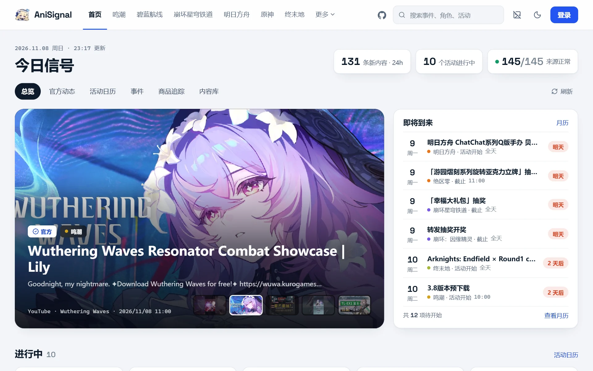
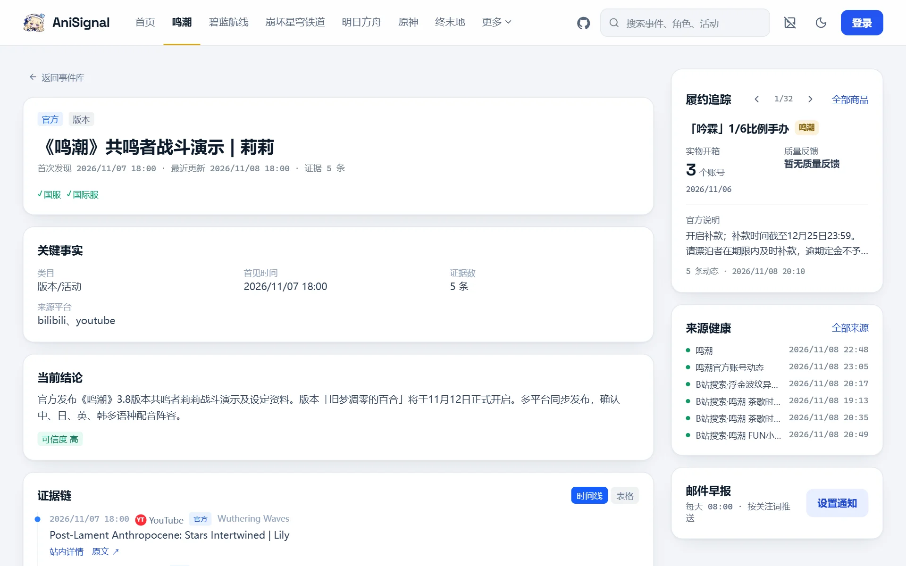
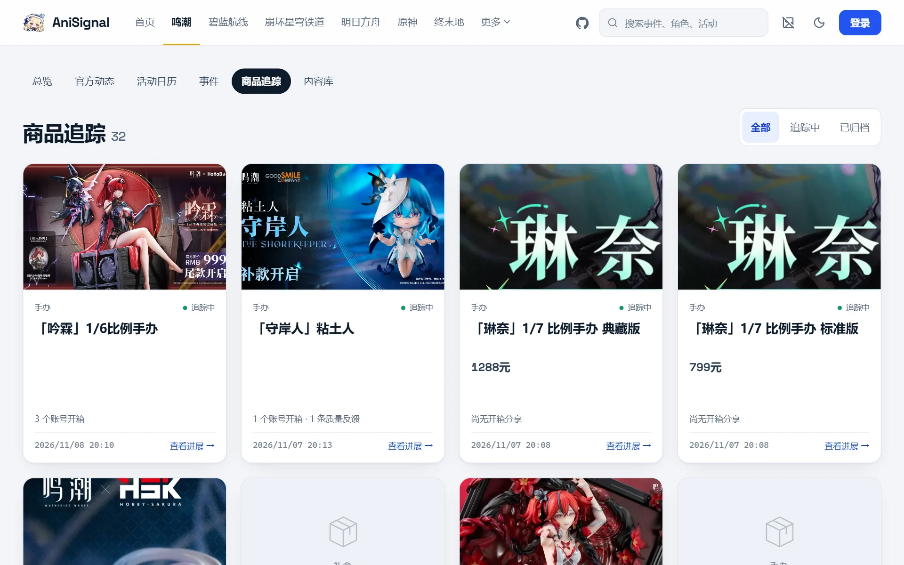
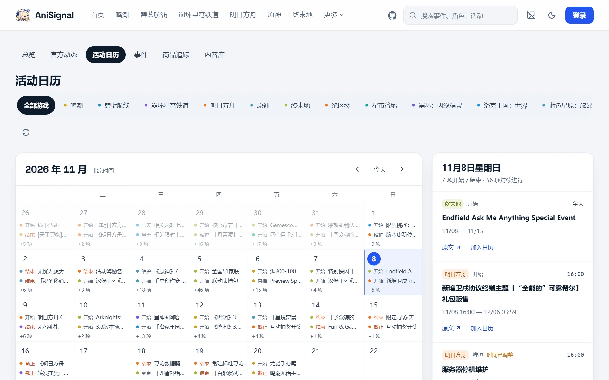
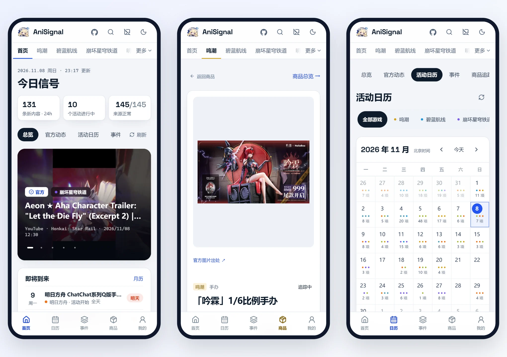
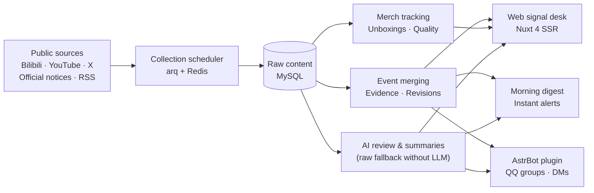

<div align="center">


# AniSignal

**Let what matters find you.**

A self-hosted multi-section signal desk for game updates, industry news, and merchandise tracking. It gathers public updates from official accounts, site notices, videos, communities, and RSS feeds, merges them into traceable events, and delivers what you follow to the web, email, and QQ.

<p>
<a href="https://github.com/tianyin231/AniSignal/actions/workflows/ci.yml"></a>
<a href="LICENSE"></a>


</p>

**[Live Demo](https://anisignal.xyz/)** · [Interactive Tour](https://anisignal.xyz/intro) · [Quick Start](#quick-start) · [Deployment](docs/deployment.md) · [Changelog](https://anisignal.xyz/project) · [Issues](https://github.com/tianyin231/AniSignal/issues)

[简体中文](README.md) · **English**

</div>

<a href="https://anisignal.xyz/">
  <picture>
    <source media="(prefers-color-scheme: dark)" srcset="docs/assets/readme/home-dark.webp">
    
  </picture>
</a>

Following a game's next version, a figure's shipping status, or fast-moving AI releases usually means bouncing between official accounts, websites, videos, community boards, and RSS feeds. AniSignal watches those public sources for you: scattered posts about the same thing become one event with every source cited, merchandise is followed from pre-order to the first unboxings, and new hits on your keywords are pushed to you.

> The interface and most preset sources are in Chinese, while custom sections and RSS/YouTube/X sources work with any language.

## Features

<table>
  <tr>
    <td width="50%" valign="top">
      
      <p><b>Event tracking</b><br>Official posts, videos and reposts about the same thing are merged automatically, keeping the evidence chain, first-seen time and revision history, with a confidence level on the conclusion.</p>
    </td>
    <td width="50%" valign="top">
      
      <p><b>Merchandise fulfillment</b><br>Products are detected from official announcements, then followed through final payment, shipping, real unboxings and quality reports; tracking ends on its own once delivery is confirmed.</p>
    </td>
  </tr>
  <tr>
    <td width="50%" valign="top">
      
      <p><b>Event calendar</b><br>Start and end times of events, banners and giveaways are extracted from announcements, filterable by section and one click away from your own calendar.</p>
    </td>
    <td width="50%" valign="top">
      
      <p><b>Built for phones</b><br>Bottom navigation, touch-sized controls and light / dark themes laid out for small screens, so a shared link just works.</p>
    </td>
  </tr>
</table>

Also included:

- **Custom sections & one-click source presets**: New instances start with a clean empty database; create custom sections, toggle built-in sections, import preset source packs per section in one click, or bulk enable/disable/remove monitored sources from `/admin/targets` without touching code.
- **Zero-SSH web setup & Bilibili QR login**: Scan a QR code or paste cookies directly in `/admin/targets` for Bilibili collection; manage AI keys, proxies, and site branding in the web console.
- **Graceful operation without AI or SMTP**: Without an LLM key, rule-based event merging works out of the box and `/ai` can display original raw feed items directly; without SMTP, admins can view pending registration codes, activate accounts, or reset passwords in `/admin/users`.
- **Follows and delivery**: Keyword follows on the site, or standalone Bilibili UID / keyword custom monitors; a 08:00 (UTC+8) morning email digest and instant alerts.
- **QQ bot**: Companion AstrBot plugin for QQ official groups and NapCat that pushes rich briefs and answers queries in chat.

## Sections & Presets

14 built-in game sections plus AI News presets are ready for optional one-click import, and you can create **unlimited custom sections** in `/admin/targets`:

| Section | Preset sources |
| :--- | :--- |
| Wuthering Waves | Official Bilibili & merch account, Kuro official notices (CN/Global), YouTube, community search |
| Genshin Impact · Arknights: Endfield | Official Bilibili, official notices, YouTube, community videos (Genshin also includes Miyoushe) |
| Honkai: Star Rail · Arknights · Azur Lane | Official Bilibili, YouTube, community videos |
| Goddess of Victory: NIKKE | Official notices, YouTube, community videos |
| Zenless Zone Zero · Infinity Nikki · Petit Planet · Honkai: Nexus Anima · Roco Kingdom: World · Azur Promilia · Neverness to Everness | Official Bilibili, community videos |
| AI News | First-party RSS feeds (OpenAI, Anthropic, Google AI, DeepMind, Hugging Face, etc.) & Bilibili search (X accounts disabled by default) |
| Custom sections (admin-created) | Any Bilibili account/search, YouTube channel, RSS/Atom feed, Miyoushe, or X source |

Navigation shows all enabled sections, with one-click hiding for empty sections in the admin panel.

## Architecture



The backend is FastAPI + SQLAlchemy (async) + MySQL 8.4 with a Redis / arq task queue; the frontend is Nuxt 4 SSR + Tailwind CSS 4. Production runs with a single Docker Compose command, and local development can use SQLite alone.

## Quick Start

### Production (Docker Compose)

Requirements: Git, Docker 24+, Docker Compose v2, and **at least 2 GB RAM** (official pre-built multi-arch images at `ghcr.io/tianyin231/anisignal` support both `linux/amd64` and `linux/arm64` with zero on-server compilation).

```bash
git clone https://github.com/tianyin231/AniSignal.git
cd AniSignal
cp .env.example .env
```

Edit `.env`:

- `MYSQL_ROOT_PASSWORD`: strong random password for MySQL (wrap in single quotes `'...'` if it contains `$` or `#`);
- `ANISIGNAL_ADMIN_TOKEN`: initial bootstrap token for `/admin` (do not leave `change-me`; can be bound to your personal site account on first login);
- `ANISIGNAL_PUBLIC_BASE_URL`: external site URL (`http://127.0.0.1:8090` for local testing, or `https://signal.example.com` behind HTTPS reverse proxy);
- `WEB_PORT`: host bind address and port (defaults to `127.0.0.1:8090`; set `0.0.0.0:8090` for direct LAN access).

Start the stack (append `--build` only if you modified local source files):

```bash
docker compose up -d
docker compose ps
```

Open **`http://127.0.0.1:8090/admin`** with your `ANISIGNAL_ADMIN_TOKEN` (you can bind your logged-in site account as an admin in one click so future visits enter `/admin` directly without re-entering the token) and follow the 3-step onboarding card:

1. **Sections & Sources (`/admin/targets`)**: Create custom sections, import preset source packs in one click, or add/remove sources in bulk; scan a QR code or paste cookies for Bilibili if needed.
2. **AI Models (optional, `/admin/ai`)**: Configure an OpenAI-compatible endpoint for summaries, calendar extraction, merch discovery, and curated AI News (or browse raw items directly without AI).
3. **Users & Email (optional, `/admin/settings` & `/admin/users`)**: Configure SMTP for digests and password resets, or manage verification codes and user passwords directly in `/admin/users` without SMTP.

> Using a Clash / mihomo TUN `fake-ip` proxy? Uncomment `ANISIGNAL_EGRESS_ALLOW_CIDRS=198.18.0.0/15` in `.env` so SSRF protection allows fake-ip ranges (`198.18.0.0/15`). See the [deployment guide](docs/deployment.md) for details.

### Local development

Locally the backend can run on SQLite with an in-process queue, without MySQL or Redis:

```bash
# Backend (Python 3.12+ / uv)
cd server
uv run python -m app.local

# Frontend (Node.js 22 / npm, same as the build image)
cd web
npm ci
npm run dev
```

See the [deployment guide](docs/deployment.md) for reverse proxy templates (`docs/examples/nginx.conf`), China mirror options, backups, and troubleshooting.

## QQ via AstrBot

The plugin source lives in `integrations/astrbot_plugin_anisignal` and is published to the standalone repository [AstrBot_Plugin_AniSignal](https://github.com/tianyin231/AstrBot_Plugin_AniSignal):

1. In the AstrBot panel, open "Plugin Management → Install from Link" and enter `https://github.com/tianyin231/AstrBot_Plugin_AniSignal`;
2. fill in your AniSignal server URL and access key;
3. send `/情报订阅` or `/帮助` in a group or private chat to choose sections and delivery.

See the [plugin guide](integrations/astrbot_plugin_anisignal/README.md) for details.

## Documentation

- [Deployment & operations](docs/deployment.md): Docker Compose, Nginx reverse proxy, fake-ip/mirrors, backups, and troubleshooting
- [Features & architecture](docs/features.md): the three ways to follow, idempotent ingestion, and event merging
- [Backend](server/README.md): FastAPI layout, Alembic migrations, and collector interfaces
- [Frontend](web/README.md): Nuxt 4 structure and Signal Desk design tokens

When filing an issue, please include the page path, reproduction steps, deployment mode, and sanitized logs.

## License

Copyright © 2026 tianyin231 and contributors. AniSignal is released under the [GNU AGPL-3.0](LICENSE): you may use, modify, and redistribute it; if you run a modified version as a network service for others, you must also publish its complete source under AGPL-3.0 (configurable via `source_url` and `contact_email` in `/admin/settings`).

## Acknowledgements

AniSignal was built by a human developer pairing with a number of large language models.

<details>
<summary>Models and tools</summary>

| Organization | Models |
| :--- | :--- |
| **Anthropic** | `Claude Opus 5.5` |
| **OpenAI** | `GPT-6.1 Sol` · `GPT-6 Astra` · `GPT-5.6 Sol` |
| **Google DeepMind** | `Gemini 4 Carbon` · `Gemini 3.8 Flash` |
| **xAI** | `Grok 4.7` |
| **StepFun** | `Step 5 Preview` |
| **Zhipu AI** | `GLM-5.3` · `GLM-5.3 Flash` |
| **Xiaomi** | `MiMo v2.6 Pro` |
| **Agnes AI** | `agnes-3.0-flash` · `agnes-2.0-flash` |

Developer tools and agent hosts: `ChatGPT(codex)` · `Claude Code` · `ZCode` · `Antigravity` · `Ponytail` · `GrokBot` · `Muse` · `GPTDots`

</details>

<div align="center">

<a href="https://github.com/tianyin231/AniSignal/graphs/contributors"></a>

<a href="https://star-history.com/#tianyin231/AniSignal&Date">
  <picture>
    <source media="(prefers-color-scheme: dark)" srcset="https://api.star-history.com/svg?repos=tianyin231/AniSignal&type=Date&theme=dark">
    
  </picture>
</a>

</div>
