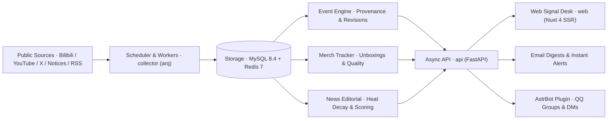

<div align="center">


# AniSignal

**Let what matters find you.**

A self-hosted, multi-section signal desk for game updates, industry news, and merchandise fulfillment.<br>
It gathers scattered public updates across official accounts, site notices, videos, and RSS feeds, consolidates them into source-backed events, and delivers what you care about to the web, email, and QQ.

<p>
<a href="https://github.com/tianyin231/AniSignal/actions/workflows/ci.yml"></a>
<a href="https://github.com/tianyin231/AniSignal/actions/workflows/docker-publish.yml"></a>
<a href="LICENSE"></a>


</p>

**[Live Demo](https://anisignal.xyz/)** · [Interactive Tour](https://anisignal.xyz/intro) · [Quick Start](#quick-start) · [Deployment](docs/deployment.md) · [Features](docs/features.md) · [Changelog](https://anisignal.xyz/project) · [Issues](https://github.com/tianyin231/AniSignal/issues)

[简体中文](README.md) · **English**

</div>

<a href="https://anisignal.xyz/">
  <picture>
    <source media="(prefers-color-scheme: dark)" srcset="docs/assets/readme/home-dark.webp">
    
  </picture>
</a>

---

Keeping up with a game's next patch, a pre-ordered figure's real shipping status, or fast-moving AI releases usually means bouncing between Bilibili, YouTube, official notice boards, community threads, and a dozen RSS feeds—where identical news gets reposted ten times while critical schedule changes and early buyer reports sink out of sight.

**AniSignal replaces unread-count fatigue with a structured signal desk:** scattered posts about the same development are consolidated into a single traceable event; multi-month merchandise pre-orders are tracked from announcement to real buyer unboxings; and industry news runs through an independent editorial pipeline with deduplication, heat decay, and daily editions—always keeping a one-click path back to the primary source.

> **Language note:** The web UI and built-in game presets default to Simplified Chinese, while custom sections, RSS/Atom feeds, YouTube channels, and X sources work with content in any language.

## Core Experience

<table>
  <tr>
    <td width="50%" valign="top">
      
      <p><b>Event Consolidation &amp; Provenance</b><br>When official posts, patch notes, trailers, and community discussions point to the same story, AniSignal merges them into one event—preserving first-seen timestamps, revision history, and source links while separating confirmed statements from rumors.</p>
    </td>
    <td width="50%" valign="top">
      
      <p><b>End-to-End Merch Fulfillment</b><br>Detects newly announced merchandise, then tracks final-payment windows, shipping notices, real unboxings, and quality feedback over months—distinguishing verified buyer units from sponsored review samples and closing tracking automatically once delivery settles.</p>
    </td>
  </tr>
  <tr>
    <td width="50%" valign="top">
      
      <p><b>Structured Event Calendar</b><br>Extracts banner windows, limited-time events, maintenance schedules, and livestreams directly from announcements into monthly calendar and countdown views, filterable by section with one-click calendar export.</p>
    </td>
    <td width="50%" valign="top">
      
      <p><b>Crafted for Mobile Screens</b><br>Bottom navigation, touch-first targets, and adaptive light / dark themes are laid out specifically for phones—so links opened from morning emails or chat briefs read effortlessly.</p>
    </td>
  </tr>
</table>

## Built for Self-Hosting

- **Clean Empty-DB Start & Custom Sections**: Fresh deployments boot with zero demo clutter. Create **custom sections** for any game, anime, open-source project, or beat right from `/admin/targets`—or import any of the 15 built-in preset source packs in one click, with bulk enable, disable, and cleanup controls.
- **Progressive Dependencies (No LLM or SMTP Required)**: AI and email are *optional enhancements*, never hard boot requirements. Without an LLM key, rule-based event merging and multi-platform ingestion run normally, and `/ai` offers a one-click raw-feed view; without SMTP, admins can copy pending registration codes, activate users, or reset passwords directly in `/admin/users`.
- **Zero-SSH Web Administration**: Bilibili login is optional (keyword search and uploader videos work anonymously; login improves dynamics success rate) and can be done in `/admin/targets` via QR scan, password, SMS code, or cookie paste; manage OpenAI-compatible key pools, per-platform HTTP/SOCKS collector proxies, and site compliance links live in the browser. Every source tracks its own health score with automatic exponential backoff.
- **Three-Tier Following & Multi-Channel Delivery**: Beyond public section sources curated by admins, users can subscribe to **title keywords** or run isolated **custom monitors** (Bilibili keyword / uploader, RSS / Atom, or YouTube channel; public or private; 3 per user by default), delivered via 08:00 (UTC+8) morning digests, instant alerts, or **QQ group / DM bots**.

## Source Adapters & Built-In Presets

Native collectors cover **Bilibili** (official dynamics, user videos, keyword search), **YouTube** (keyless channel RSS by default, optional Data API v3), **Miyoushe**, **official game notice boards**, **standard RSS / Atom**, and **public X (Twitter) accounts**.

14 game section packs plus an AI News pack ship ready for optional one-click import alongside unlimited custom sections:

| Category | Sections | Preset Sources |
| :--- | :--- | :--- |
| **Full Game Packs** | Wuthering Waves · Genshin Impact · Arknights: Endfield | Official Bilibili (incl. merch / Miyoushe), official site notices, YouTube channels, community video search |
| **Multi-Source Packs** | Honkai: Star Rail · Arknights · Azur Lane · Goddess of Victory: NIKKE | Official Bilibili / site notices, YouTube channels, community video search |
| **Lightweight Packs** | Zenless Zone Zero · Infinity Nikki · Petit Planet · Honkai: Nexus Anima · Roco Kingdom: World · Azur Promilia · Neverness to Everness | Official Bilibili posts & videos, curated community search |
| **Editorial Newsroom** | AI News (`/ai`) | First-party RSS (OpenAI, Anthropic, Google AI, DeepMind, Hugging Face, etc.), Bilibili search & optional X accounts; 48h entity heat decay, dual-pass scoring & 08:00 daily editions |
| **Custom Sections** | Unlimited admin-defined sections (slug, title, palette & aliases) | Any combination of Bilibili, YouTube, RSS/Atom, Miyoushe, or X targets, with per-target `Official` identity badges |

## Architecture



Production runs a clean **5-container topology** (`mysql`, `redis`, `api`, `web`, `collector`): `api`, `web`, and `collector` share a single multi-arch image without duplicating disk layers while isolating logs and scaling (`collector` uses Redis-backed leader election and per-target locks for safe horizontal scaling). For local development, the entire backend drops down to **SQLite + an in-process queue** with zero container dependencies.

## Quick Start

### Option 1: Docker Compose (Recommended)

Requires Git, Docker 24+, Docker Compose v2, and **≥ 2 GB RAM**. Official pre-built images at `ghcr.io/tianyin231/anisignal` support both `linux/amd64` and `linux/arm64` out of the box—no on-server builds needed.

**1. Configure `.env`**

```bash
git clone https://github.com/tianyin231/AniSignal.git
cd AniSignal
cp .env.example .env
```

Edit the core settings in `.env`:

| Variable | Required | Description |
| :--- | :---: | :--- |
| `MYSQL_ROOT_PASSWORD` | Yes | Strong random MySQL password (e.g. `openssl rand -hex 24`) |
| `ANISIGNAL_ADMIN_TOKEN` | Yes | Initial bootstrap token for `/admin` (replace `change-me` with a random secret) |
| `ANISIGNAL_PUBLIC_BASE_URL` | Recommended | External site URL (`http://127.0.0.1:8090` locally, or `https://signal.example.com` in production) |
| `WEB_PORT` | No | Host bind address (`127.0.0.1:8090` behind a reverse proxy, or `0.0.0.0:8090` for direct LAN access) |

**2. Launch the stack**

```bash
docker compose up -d
docker compose ps
```

**3. Complete 3-step onboarding in the browser**

Open **`http://127.0.0.1:8090/admin`** and enter `ANISIGNAL_ADMIN_TOKEN` (you can bind your personal site account as an admin on first login so future visits enter `/admin` directly from the avatar menu):

1. **Sections & Sources (`/admin/targets`)**: Create custom sections, import preset packs in one click, and optionally scan a QR code for Bilibili login.
2. **AI Models (optional, `/admin/ai`)**: Connect any OpenAI-compatible endpoint to unlock summaries, calendar extraction, merch discovery, and curated AI News.
3. **Email & Branding (optional, `/admin/settings` & `/admin/users`)**: Configure SMTP for digests and password resets, or manage verification codes directly in `/admin/users`.

> **Environment tips:** Wrap `.env` passwords containing `$` or `#` in single quotes `'...'` so Compose does not interpolate or truncate them. If your host uses a Clash / mihomo TUN `fake-ip` proxy, set `ANISIGNAL_EGRESS_ALLOW_CIDRS=198.18.0.0/15` in `.env`. See the [Deployment & Operations Guide](docs/deployment.md) for Nginx HTTPS templates, SELinux/macOS volume notes, and backups.

### Option 2: Local Development (No Docker / MySQL / Redis)

Requires **Python 3.12+ (`uv`)** and **Node.js 22 (`npm`)**:

```bash
# Terminal 1: Backend (SQLite ./server/local.db + in-process queue, default admin token: local-dev)
cd server
uv run python -m app.local

# Terminal 2: Frontend dev server (http://localhost:3000)
cd web
npm ci
npm run dev
```

## QQ Bot Integration (AstrBot)

The companion plugin lives in [`integrations/astrbot_plugin_anisignal`](integrations/astrbot_plugin_anisignal) and is published to [AstrBot_Plugin_AniSignal](https://github.com/tianyin231/AstrBot_Plugin_AniSignal) for both official QQ bots and OneBot v11 (NapCat):

1. In the AstrBot dashboard, open **Plugin Management → Install from Link** and enter `https://github.com/tianyin231/AstrBot_Plugin_AniSignal`;
2. Configure your AniSignal URL and bot access key;
3. Send `/情报订阅` or `/帮助` in a group or DM to subscribe to sections, illustrated morning briefs, instant alerts, and keyword queries.

See the [plugin README](integrations/astrbot_plugin_anisignal/README.md) for full command reference.

## Documentation

| Guide | Topics |
| :--- | :--- |
| [Deployment & Operations](docs/deployment.md) | 5-container topology, Nginx HTTPS template, proxy pools & fake-ip, backups, and recovery |
| [Features & Architecture](docs/features.md) | Following tiers, idempotent ingestion, event merging, AI News scoring, and merch fulfillment |
| [Backend Reference](server/README.md) | FastAPI layout, Alembic migrations, collector adapter interfaces, and test suite |
| [Frontend Reference](web/README.md) | Nuxt 4 SSR layout, Signal Desk design tokens, and component conventions |
| [Contributing](CONTRIBUTING.md) · [Security](SECURITY.md) | Local workflow, privacy & SSRF guardrails, and private vulnerability reporting |

## License

Copyright © 2026 tianyin231 and contributors. Released under the [GNU AGPL-3.0](LICENSE): you are free to use, modify, and redistribute this software; if you run a modified version as a network service for others, you must make its complete source code available under AGPL-3.0 (configurable via `source_url` and `contact_email` in `/admin/settings`).

## Acknowledgements

AniSignal was built through iterative pair-programming between a human developer and large language models.

<details>
<summary>Participating models and developer tools</summary>

| Organization | Models |
| :--- | :--- |
| **Anthropic** | `Claude Opus 5.5` |
| **OpenAI** | `GPT-6.1 Sol` · `GPT-6 Astra` · `GPT-5.6 Sol` |
| **Google DeepMind** | `Gemini 4 Carbon` · `Gemini 3.8 Flash` |
| **xAI** | `Grok 4.7` |
| **StepFun** | `Step 5 Preview` |
| **Zhipu AI** | `GLM-5.3` · `GLM-5.3 Flash` |
| **Xiaomi** | `MiMo v2.6 Pro` |
| **Agnes AI** | `agnes-3.0-flash` · `agnes-2.0-flash` |

Developer tools and agent hosts: `ChatGPT(codex)` · `Claude Code` · `ZCode` · `Antigravity` · `Ponytail` · `GrokBot` · `Muse` · `GPTDots`

</details>

<div align="center">

<a href="https://github.com/tianyin231/AniSignal/graphs/contributors"></a>

<a href="https://star-history.com/#tianyin231/AniSignal&Date">
  <picture>
    <source media="(prefers-color-scheme: dark)" srcset="https://api.star-history.com/svg?repos=tianyin231/AniSignal&type=Date&theme=dark">
    
  </picture>
</a>

</div>
