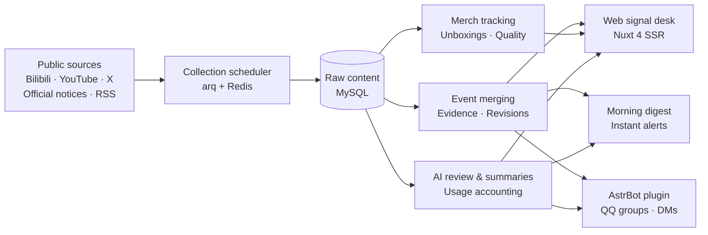

<div align="center">


# AniSignal

**Let what matters find you.**

A self-hosted signal desk for game news and merchandise tracking. It gathers public updates from official accounts,
site notices, videos and communities, merges them into events with traceable sources, and delivers what you follow to the web, email and QQ.

<p>
<a href="https://github.com/tianyin231/AniSignal/actions/workflows/ci.yml"></a>
<a href="LICENSE"></a>


</p>

**[Live Demo](https://anisignal.xyz/)** · [Interactive Tour](https://anisignal.xyz/intro) · [Quick Start](#quick-start) · [Deployment](docs/deployment.md) · [Changelog](https://anisignal.xyz/project) · [Issues](https://github.com/tianyin231/AniSignal/issues)

[简体中文](README.md) · **English**

</div>

<a href="https://anisignal.xyz/">
  <picture>
    <source media="(prefers-color-scheme: dark)" srcset="docs/assets/readme/home-dark.webp">
    
  </picture>
</a>

Following a game's next version or a figure's shipping status usually means bouncing between official accounts, websites, videos and community boards, and telling real news apart from reposts. AniSignal watches those public sources for you: scattered posts about the same thing become one event with every source cited, merchandise is followed from pre-order to the first unboxings, and new hits on your keywords are pushed to you.

> The interface and most of the collected content are in Chinese.

## Features

<table>
  <tr>
    <td width="50%" valign="top">
      
      <p><b>Event tracking</b><br>Official posts, videos and reposts about the same thing are merged automatically, keeping the evidence chain, first-seen time and revision history, with a confidence level on the conclusion.</p>
    </td>
    <td width="50%" valign="top">
      
      <p><b>Merchandise fulfillment</b><br>Products are detected from official announcements, then followed through final payment, shipping, real unboxings and quality reports; tracking ends on its own once delivery is confirmed.</p>
    </td>
  </tr>
  <tr>
    <td width="50%" valign="top">
      
      <p><b>Event calendar</b><br>Start and end times of events, banners and giveaways are extracted from announcements, filterable by game and one click away from your own calendar.</p>
    </td>
    <td width="50%" valign="top">
      
      <p><b>Built for phones</b><br>Bottom navigation, touch-sized controls and light / dark themes laid out for small screens, so a shared link just works.</p>
    </td>
  </tr>
</table>

Also included:

- **Multi-platform collection**: official Bilibili posts and videos, YouTube, X, official game site notices and RSS; every source has its own health record and backs off automatically on failure.
- **Follows and delivery**: keyword follows on the site, or standalone Bilibili UID / keyword monitors; a morning email digest at 08:00 and instant alerts for important news.
- **QQ bot**: a companion AstrBot plugin for QQ official groups and NapCat that pushes rich briefs and answers queries in chat.
- **AI News**: model releases and industry news, scored in two passes, translated into Chinese and grouped, browsed separately from the game sections.
- **Admin console**: `/admin` manages sources, review, classification rules, users and broadcast emails, with live accounting of model cost and token usage.

## Sections

14 game sections plus AI News. Open a single game, or see everything on the home page.

| Section | Main sources |
| :--- | :--- |
| Wuthering Waves | Official Bilibili, Kuro official notices, YouTube, popular community videos |
| Genshin Impact · Arknights: Endfield | Official Bilibili, official notices, X, YouTube, community videos (Genshin also includes Miyoushe) |
| Honkai: Star Rail · Arknights · Azur Lane | Official Bilibili, YouTube, community videos |
| Goddess of Victory: NIKKE | Official notices, X, YouTube |
| Zenless Zone Zero · Infinity Nikki · Petit Planet · Honkai: Nexus Anima · Roco Kingdom: World · Azur Promilia · Neverness to Everness | Official Bilibili, popular community videos |
| AI News | RSS news feeds, AI-related accounts on X, Bilibili search |

Sources can be added or removed from the admin console at any time; the table reflects the public site's current setup.

## Architecture



The backend is FastAPI + SQLAlchemy (async) + MySQL 8.4 with a Redis / arq task queue; the frontend is Nuxt 4 SSR + Tailwind CSS 4. Production runs with a single Docker Compose command, and local development can use SQLite alone.

## Quick Start

### Production (Docker Compose)

Requirements: Git, Docker 24+ and Docker Compose v2.

```bash
git clone https://github.com/tianyin231/AniSignal.git
cd AniSignal
cp .env.example .env
```

Edit `.env`:

- set `ANISIGNAL_ADMIN_TOKEN` to a long random string (the admin console's access token);
- set `MYSQL_ROOT_PASSWORD` and `MYSQL_PASSWORD`;
- adjust the listening port if needed (default `WEB_PORT=127.0.0.1:8090`).

Start it:

```bash
docker compose up -d --build
docker compose ps
```

Open **`http://127.0.0.1:8090`** to browse. Go to `/admin` with the admin token to start configuring sources, rules and AI.

### Local development

Locally the backend can run on SQLite with an in-process queue, without MySQL or Redis:

```bash
# Backend (Python 3.12+ / uv)
cd server
uv run python -m app.local

# Frontend (Node.js 22 / npm, same as the build image)
cd web
npm ci
npm run dev
```

See the [deployment guide](docs/deployment.md) for full configuration and environment variables.

## QQ via AstrBot

The plugin source lives in `integrations/astrbot_plugin_anisignal` and is published to the standalone repository [AstrBot_Plugin_AniSignal](https://github.com/tianyin231/AstrBot_Plugin_AniSignal):

1. In the AstrBot panel, open "Plugin Management → Install from Link" and enter the plugin repository `https://github.com/tianyin231/AstrBot_Plugin_AniSignal`;
2. fill in your AniSignal server URL and access key;
3. send `/情报订阅` or `/帮助` in a group or private chat to choose sections and delivery.

It supports morning digests, instant alerts for important news, rich briefs, session persona inheritance and keyword queries. See the [plugin guide](integrations/astrbot_plugin_anisignal/README.md).

## Documentation

- [Features & architecture](docs/features.md): the three ways to follow, idempotent ingestion and event merging
- [Deployment & operations](docs/deployment.md): containers, server updates and proxy setup
- [Backend](server/README.md): FastAPI layout, Alembic migrations and collector interfaces
- [Frontend](web/README.md): Nuxt 4 structure and Signal Desk design tokens

When filing an issue, please include the page path, reproduction steps, deployment mode and sanitized logs.

## License

Copyright © 2026 tianyin231 and contributors. AniSignal is released under the [GNU AGPL-3.0](LICENSE): you may use, modify and redistribute it; if you run a modified version as a network service for others, you must also publish its complete source under AGPL-3.0.

`integrations/aihot` contains the third-party project [AIHOT](https://github.com/KKKKhazix/AIHOT), distributed under its original MIT License (see `LICENSE` and `NOTICE` in that directory). The "AIHOT" name and logo are not covered by that license.

## Acknowledgements

AniSignal was built by a human developer pairing with a number of large language models.

<details>
<summary>Models and tools</summary>

| Organization | Models |
| :--- | :--- |
| **Anthropic** | `Claude Opus 5.5` |
| **OpenAI** | `GPT-6.1 Sol` · `GPT-6 Astra` · `GPT-5.6 Sol` |
| **Google DeepMind** | `Gemini 3.8 Flash` |
| **xAI** | `Grok 4.7` |
| **StepFun** | `Step 5 Preview` |
| **Zhipu AI** | `GLM-5.3` · `GLM-5.3 Flash` |
| **Xiaomi** | `MiMo v2.6 Pro` |
| **Agnes AI** | `agnes-3.0-flash` · `agnes-2.0-flash` |

Developer tools and agent hosts: `ChatGPT(codex)` · `Claude Code` · `ZCode` · `Antigravity` · `GrokBot` · `Muse` · `GPTDots`

</details>

<div align="center">

<a href="https://github.com/tianyin231/AniSignal/graphs/contributors"></a>

<a href="https://star-history.com/#tianyin231/AniSignal&Date">
  <picture>
    <source media="(prefers-color-scheme: dark)" srcset="https://api.star-history.com/svg?repos=tianyin231/AniSignal&type=Date&theme=dark">
    
  </picture>
</a>

</div>
