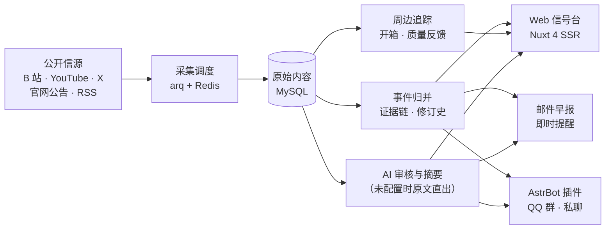

<div align="center">


# AniSignal

**让重要的变化，主动找到你。**

自托管的多分区资讯与周边追踪信号台。把官号、官网公告、视频、社区和 RSS 里的公开更新汇到一处，<br>
自动归并成有出处可查的事件，再按你的关注送到网页、邮件和 QQ。

<p>
<a href="https://github.com/tianyin231/AniSignal/actions/workflows/ci.yml"></a>
<a href="LICENSE"></a>


</p>

**[在线体验](https://anisignal.xyz/)** · [交互演示](https://anisignal.xyz/intro) · [快速开始](#快速开始) · [部署指南](docs/deployment.md) · [更新记录](https://anisignal.xyz/project) · [反馈问题](https://github.com/tianyin231/AniSignal/issues)

**简体中文** · [English](README.en.md)

</div>

<a href="https://anisignal.xyz/">
  <picture>
    <source media="(prefers-color-scheme: dark)" srcset="docs/assets/readme/home-dark.webp">
    
  </picture>
</a>

关注一款游戏的版本、一件周边的发货或一条行业快讯，往往要在官号、官网、视频、社区与 RSS 之间来回翻，还要分辨哪些是营销号转载。AniSignal 替你盯着这些公开来源：同一件事的零散消息合并成一条事件，每条消息都标明出处；周边从开订一路追到实物开箱；你关心的关键词有新动静，会主动推送给你。

## 功能一览

<table>
  <tr>
    <td width="50%" valign="top">
      
      <p><b>事件追踪</b><br>官号、视频与转载里说的是同一件事时自动归并，保留证据链、首见时间和修订记录，结论附可信度。</p>
    </td>
    <td width="50%" valign="top">
      
      <p><b>周边履约</b><br>从官方公告里识别周边商品，持续追踪尾款、发货、实物开箱和质量反馈，确认到货后自动结束追踪。</p>
    </td>
  </tr>
  <tr>
    <td width="50%" valign="top">
      
      <p><b>活动日历</b><br>从公告里提取活动、卡池、抽奖的开始与截止时间，按分区筛选，可一键加入自己的日历。</p>
    </td>
    <td width="50%" valign="top">
      
      <p><b>手机友好</b><br>底部导航、触控尺寸与浅色 / 深色主题都按手机重新排版，打开链接就能看。</p>
    </td>
  </tr>
</table>

此外还有：

- **完全自定义分区与信源**：新实例默认空库干净启动，不强塞演示数据；后台支持**一键新增自定义分区**、隐藏不需要的内置分区、**按分区一键导入预设信源**，以及多选批量启停或移除监控源。
- **多平台采集与网页扫码**：B 站官号动态与视频（后台直接扫码或粘贴 Cookie 登录，无需 SSH）、YouTube、米游社、游戏官网公告、标准 RSS 与 X；每个来源独立记录健康度，失败自动退避。
- **无 AI / 无 SMTP 也可开箱使用**：未配置大模型时，游戏规则归并照常工作，`/ai` 快讯支持切换「原文直出」浏览原始资讯；未配置 SMTP 时，管理员可在后台查看注册验证码、一键激活账号或重置密码。
- **关注与推送**：站内关键词关注，或创建独立的 B 站 UID / 关键词定制监控；支持每天 08:00 邮件早报与重要消息即时提醒。
- **QQ 机器人**：配套 AstrBot 插件，支持 QQ 官方群与 NapCat，推送图文简报，也能在群里直接查询。

## 分区与预设信源

内置 14 个游戏分区与 AI 快讯预设包，同时支持在后台 `/admin/targets` 随时**新建任意自定义分区**（无需修改代码或重新构建镜像）：

| 分区 | 预设包主要信源 |
| :--- | :--- |
| 鸣潮 | B 站官号及周边号、库洛官网公告（国服/国际服）、YouTube、社区搜索 |
| 原神 · 明日方舟：终末地 | B 站官号、官网公告、YouTube、社区视频（原神另含米游社） |
| 崩坏：星穹铁道 · 明日方舟 · 碧蓝航线 | B 站官号、YouTube、社区视频 |
| 胜利女神：NIKKE | 官网公告、YouTube、社区视频 |
| 绝区零 · 无限暖暖 · 星布谷地 · 崩坏：因缘精灵 · 洛克王国：世界 · 蓝色星原：旅谣 · 异环 | B 站官号、社区视频 |
| AI 快讯 | OpenAI / Anthropic / Google AI / DeepMind / Hugging Face 等一手 RSS、B 站搜索（X 源默认停用，按需开启） |
| 自定义分区（后台自建） | 任意 B 站账号/搜索、YouTube 频道、标准 RSS、米游社、X 等监控源 |

顶栏与侧栏仅展示已启用且有活跃信源的分区，也可在后台手动启停任意分区。

## 架构



后端是 FastAPI + SQLAlchemy（异步）+ MySQL 8.4，任务队列用 Redis / arq；前端是 Nuxt 4 SSR + Tailwind CSS 4。生产环境由 Docker Compose 一键启动，本地开发可以只用 SQLite。

## 快速开始

### 生产部署（Docker Compose，5 分钟从零跑通）

环境要求：Git、Docker 24+（含 Buildx）与 Docker Compose v2，建议机器内存 **≥ 2 GB**（支持 `linux/amd64` 与 `linux/arm64`）。

```bash
git clone https://github.com/tianyin231/AniSignal.git
cd AniSignal
cp .env.example .env
```

编辑 `.env`：

- `MYSQL_ROOT_PASSWORD`：数据库密码（随机长字符串，支持特殊字符自动编码）；
- `ANISIGNAL_ADMIN_TOKEN`：管理后台登录令牌（随机长字符串，不能保留 `change-me`）；
- `ANISIGNAL_PUBLIC_BASE_URL`：对外访问地址（本机试用保持 `http://127.0.0.1:8090`；绑定域名时填 `https://signal.example.com`）；
- `WEB_PORT`：宿主机监听地址（默认 `127.0.0.1:8090` 仅本机反代访问；局域网直连可改为 `0.0.0.0:8090`）。

启动服务：

```bash
docker compose up -d --build
docker compose ps
```

打开 **`http://127.0.0.1:8090/admin`** 输入 `ANISIGNAL_ADMIN_TOKEN`，按后台首页的 **3 步初始化引导**即可在浏览器内完成全部配置（无需再登 SSH）：

1. **定制分区与信源（`/admin/targets`）**：新建自定义分区或开关内置分区，点击「导入预设信源」一键导入所需分区，或手动添加 / 批量移除监控源；如需采集 B 站动态，直接在同页扫码或粘贴 Cookie 登录。
2. **AI 模型（可选，`/admin/ai`）**：填入任意 OpenAI 兼容接口（摘要、日历抽取、周边自动建档与 AI 快讯精炼依赖模型；暂不配置也可直接看规则归并事件与原文直出）。
3. **用户与邮件（可选，`/admin/settings` & `/admin/users`）**：配置 SMTP 开启邮件早报与自助找回密码；未配 SMTP 时可在 `/admin/users` 查看待用注册码、手动激活或重置用户密码。

> 国内网络如果开启了 Clash / mihomo TUN `fake-ip` 模式导致 RSS 提示非公网地址，在 `.env` 中设置 `ANISIGNAL_EGRESS_ALLOW_CIDRS=198.18.0.0/15` 后执行 `docker compose up -d` 即可。详见[部署与运维手册](docs/deployment.md)。

### 本地开发

本地开发时后端可以直接用 SQLite 和进程内队列，不需要 MySQL 和 Redis：

```bash
# 后端（Python 3.12+ / uv）
cd server
uv run python -m app.local

# 前端（Node.js 22 / npm，与构建镜像一致）
cd web
npm ci
npm run dev
```

完整配置、反向代理模板（`docs/examples/nginx.conf`）、跨平台注意事项与备份恢复说明见[部署与运维手册](docs/deployment.md)。

## 接入 QQ（AstrBot 插件）

插件源码位于 `integrations/astrbot_plugin_anisignal`，发布到独立仓库 [AstrBot_Plugin_AniSignal](https://github.com/tianyin231/AstrBot_Plugin_AniSignal)：

1. 在 AstrBot 管理面板的「插件管理 → 从链接安装」中填入插件仓库地址 `https://github.com/tianyin231/AstrBot_Plugin_AniSignal`；
2. 填写 AniSignal 服务地址与授权密钥；
3. 在群聊或私聊里发送 `/情报订阅` 或 `/帮助`，设置要接收的分区和推送方式。

支持每日早报、重要消息即时推送、图文简报、沿用会话人格和关键词查询，详见[插件使用说明](integrations/astrbot_plugin_anisignal/README.md)。

## 文档

- [部署与运维手册](docs/deployment.md)：容器编排、国内网络/fake-ip、Nginx 反代、备份与故障排查
- [功能与架构指南](docs/features.md)：三种关注方式、数据幂等与事件聚合原理
- [后端说明](server/README.md)：FastAPI 结构、Alembic 迁移与采集器接口
- [前端说明](web/README.md)：Nuxt 4 目录结构与信号台设计令牌

反馈问题时，请附上访问路径、复现步骤、部署方式和脱敏后的日志。

## 许可证

Copyright © 2026 tianyin231 与贡献者。本项目以 [GNU AGPL-3.0](LICENSE) 发布：可以自由使用、修改和分发；修改后的版本如果通过网络向他人提供服务，也需要以 AGPL-3.0 公开完整源码（可在后台 `/admin/settings` 配置修改版的源码仓库地址与联系邮箱）。

## 致谢

本项目由人类开发者与多款大语言模型结对迭代构建。

<details>
<summary>协同模型与开发工具</summary>

| 研发机构 | 协同模型 |
| :--- | :--- |
| **Anthropic** | `Claude Opus 5.5` |
| **OpenAI** | `GPT-6.1 Sol` · `GPT-6 Astra` · `GPT-5.6 Sol` |
| **Google DeepMind** | `Gemini 3.8 Flash` |
| **xAI** | `Grok 4.7` |
| **StepFun** | `Step 5 Preview` |
| **Zhipu AI** | `GLM-5.3` · `GLM-5.3 Flash` |
| **Xiaomi** | `MiMo v2.6 Pro` |
| **Agnes AI** | `agnes-3.0-flash` · `agnes-2.0-flash` |

开发工具与 Agent 宿主：`ChatGPT(codex)` · `Claude Code` · `ZCode` · `Antigravity` · `GrokBot` · `Muse` · `GPTDots`

</details>

<div align="center">

<a href="https://github.com/tianyin231/AniSignal/graphs/contributors"></a>

<a href="https://star-history.com/#tianyin231/AniSignal&Date">
  <picture>
    <source media="(prefers-color-scheme: dark)" srcset="https://api.star-history.com/svg?repos=tianyin231/AniSignal&type=Date&theme=dark">
    
  </picture>
</a>

</div>
