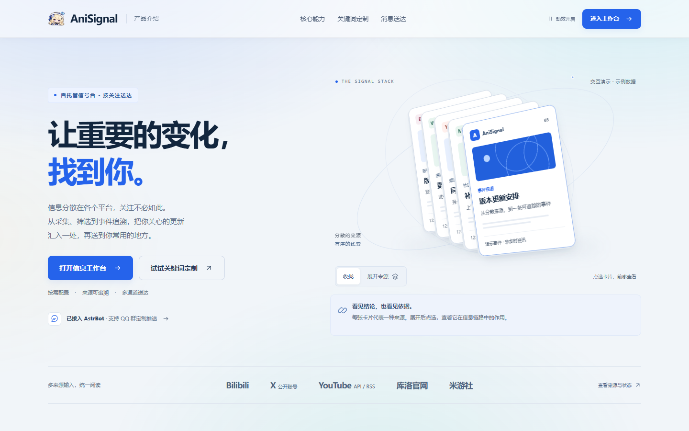

<div align="center">


# AniSignal

**让重要的变化，找到你。**

自托管的信息信号台。把多平台公开更新汇入一处，保留事件来路，按关注送达。


[在线试运行](http://anisignal.nanamiyako.cn/) · [产品介绍](http://anisignal.nanamiyako.cn/intro) · [快速开始](#快速开始) · [部署指南](docs/deployment.md) · [反馈问题](https://github.com/tianyin231/AniSignal/issues)

**简体中文** · [English](README.en.md)

</div>

---

关注一个版本、一条产品线或某件商品的进展，常常要在公告、账号动态和社区帖子之间来回查找。AniSignal 按你配置的来源持续采集，用筛选和事件归并减少重复阅读，并保留原文、证据与修订记录。

你可以在网站阅读，也可以建立关键词关注或独立监控，让邮件与可选的 AstrBot 通道送来更新。当前已有游戏与 AI 分区；试运行站展示的主题来自采集配置，扩展范围以已实现的适配器和分区注册为准。

## 页面预览

<a href="http://anisignal.nanamiyako.cn/intro"></a>

产品介绍页实拍，卡片使用标明的示例数据。[打开交互演示](http://anisignal.nanamiyako.cn/intro) · [浏览试运行站](http://anisignal.nanamiyako.cn/)

## 核心能力

| 能力 | 你能得到什么 |
| --- | --- |
| **多源采集** | 配置关键词、账号与公告目标，设置周期、共现词和热度门槛，查看来源健康。 |
| **集中阅读** | 聚合首页与独立分区，支持平台、分类和关键词筛选，保留站内预览及原文入口。 |
| **事件追溯** | 将符合规则的官方公告归并，集中查看关键事实、来源证据和修订史，保留人工修正。 |
| **AI 快讯** | 按事件归组、多来源热度和双次评分阅读模型与行业动态，保留后续进展、日报及原始出处。 |
| **商品进展** | 分别呈现官方动态、消费者到货与质量反馈，区分待核验线索和已核验信号。 |
| **个人关注** | 用关注词筛选站内内容，或创建独立的 B 站 UID／关键词监控，选择公开或私有。 |
| **多通道送达** | 可选摘要、翻译与筛选，邮件早报和手动通知，以及 AstrBot 会话推送和查询。 |
| **管理与维护** | 维护目标、内容、事件、商品、规则和用户，检查采集记录、模型用量与投递状态。 |

```text
站点采集目标 → 定时采集 → 筛选与版本化入库 → 事件与证据 → 浏览、关注与通知
个人定制监控 → 独立采集与存储 → 私有查看或公开分享 → 可选邮件
```

管理员的**采集词**决定站点抓取范围；用户的**关注词**筛选已入库内容；**定制监控**创建独立的 B 站任务，结果不进入主内容库与事件引擎。详细区别见[功能指南](docs/features.md#先区分三种关注方式)。

## 快速开始

需要 Git、Docker 与 Docker Compose。完整环境包含 MySQL、Redis、Web/API 和采集 worker。

```bash
git clone https://github.com/tianyin231/AniSignal.git
cd AniSignal
cp .env.example .env
```

编辑 `.env`：为 `ANISIGNAL_ADMIN_TOKEN` 和 `MYSQL_ROOT_PASSWORD` 分别设置独立的随机长字符串，数据库密码建议使用十六进制字符；添加 `WEB_PORT=127.0.0.1:8090`，先只监听本机。然后启动：

```bash
docker compose up -d --build
docker compose ps
```

打开 **[http://127.0.0.1:8090](http://127.0.0.1:8090)**，进入 `/admin` 并使用刚才设置的管理员 Token。配置采集目标、手动触发一次，核对来源状态和内容，再按需启用 SMTP、模型服务与机器人通道。

本地开发使用 SQLite 与进程内队列，步骤见[部署指南](docs/deployment.md)。本地模式不等于完整部署。

## 来源与运行方式

| 来源 | 已实现的接入方式 |
| --- | --- |
| Bilibili | 通过 `bili` CLI 采集账号动态和关键词视频。 |
| X | 低频读取可公开访问的账号动态，登录限制与访问失败计入来源健康。 |
| YouTube | 频道上传列表；配置 API Key 时优先 Data API v3，未配置或失败时回退 RSS。 |
| 库洛官网、米游社 | 对应站点的专用采集与解析适配器。 |

后端使用 **FastAPI + SQLAlchemy + Alembic + arq**，前端使用 **Nuxt 4 + Tailwind CSS 4**。完整部署使用 MySQL 与 Redis；本地开发使用 SQLite 与进程内队列。新增平台需要适配器，新增分区需要注册和配置。

模型输出与商品候选线索可通过原始来源核对，商品追踪不预测个人订单发货日期。邮件、模型与机器人能力分别依赖相应服务配置；试运行站的集成启用情况以实际部署为准。

## 文档

[功能与使用指南](docs/features.md) · [部署与本地开发](docs/deployment.md) · [后端说明](server/README.md) · [前端说明](web/README.md)

反馈时请写上页面路径、复现步骤、部署方式与脱敏日志。管理员 Token、邮箱密码、模型密钥和个人订阅数据请留在本地。

许可证尚未指定。
