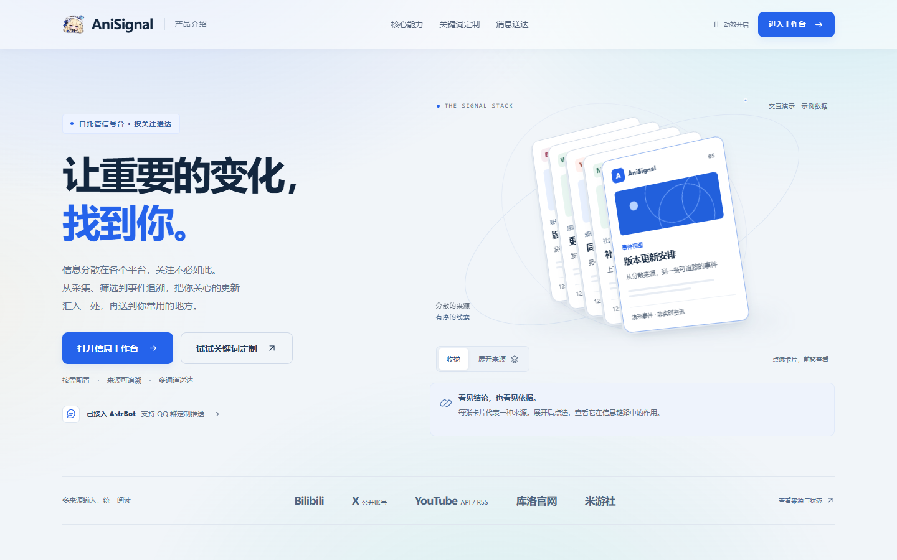
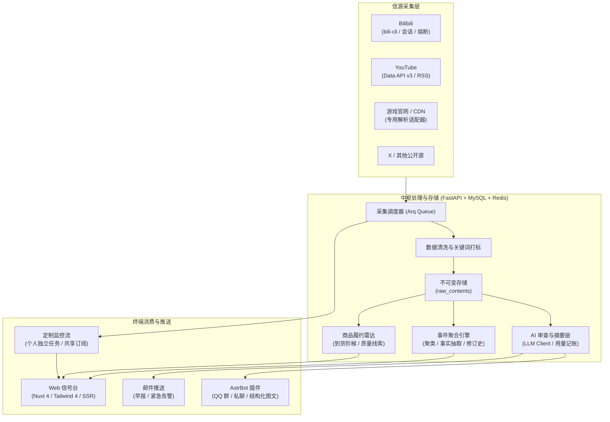

<div align="center">


# AniSignal

**让重要的变化，主动找到你。**

自托管跨平台信息信号台与事件追踪雷达。把多平台公开更新汇入一处，保留事件来路与修订证据，按关注精准送达。

<p>


<a href="https://github.com/tianyin231/AniSignal/actions/workflows/ci.yml"></a>
<a href="LICENSE"></a>

</p>

[在线试运行](https://anisignal.xyz/) · [交互演示](https://anisignal.xyz/intro) · [开源与更新](https://anisignal.xyz/project) · [快速开始](#快速开始) · [部署指南](docs/deployment.md) · [反馈问题](https://github.com/tianyin231/AniSignal/issues)

**简体中文** · [English](README.en.md)

</div>

---

关注一款游戏的重大版本、一件周边的履约进度，或科技领域的前沿进展，往往需要在多个官方站点、社媒账号与社区讨论区之间反复翻找。杂乱的营销号转载、零碎的动态和被算法淹没的关键线索，极大地消耗了精力。

AniSignal 是一套轻量但严密的**自托管信息中枢**。它持续巡查你关注的公开信源，通过去噪、语义分类与时序合并，将碎片化动态聚合为**结构化、可追溯的事件**；同时提供商品履约信号跟踪、独立定制监控队列，并支持每日早报邮件与 AstrBot 机器人定向推送。

## 界面预览

<a href="https://anisignal.xyz/intro"></a>

全站采用「信号台」设计规范，支持暗色模式与动态毛玻璃材质。[体验在线演示](https://anisignal.xyz/intro) · [访问试运行站点](https://anisignal.xyz/)

## 核心系统特性

| 模块 | 核心能力与价值 |
| :--- | :--- |
| **多源采集网络** | 支持 Bilibili（`bili` CLI 封装、账号动态与视频搜索、匿名风控熔断机制）、YouTube（Data API v3 优先 + RSS 自动回退）、X（低频公开巡检）、官方站点与游戏 CDN 直连。集成代理池与健康巡查。 |
| **多社区与游戏分区** | 原生支持鸣潮、碧蓝航线、崩坏：星穹铁道、明日方舟、原神、终末地、绝区零、NIKKE、无限暖暖等 14 个游戏分区与 AI 行业快讯。支持跨分区全局聚合视角与单分区独立频道。 |
| **不可变数据与事件引擎** | 原始抓取数据不可覆写；72 小时时间窗与文本子串自动聚类；AI 提炼结构化事实（facts）与多版本修订史（revisions）；支持人工复核锁定。 |
| **周边商品履约闭环** | 从官方正文自动识别周边情报并建档；按时间窗持续追踪送测、首开、用户批量到货与质量反馈，形成客观履约证据链。 |
| **个人关注与定制监控** | 用户可在站内配置关键词流；亦可创建完全隔离的独立 B 站 UID / 关键词定制监控任务，支持公开共享或私有推送。 |
| **多通道协同送达** | 每天 08:00 定时邮件早报、重要紧急情报即刻穿透；提供深度集成的 AstrBot 机器人插件，支持 QQ 官方群、NapCat OneBot、多图图文投递与交互式指令查询。 |
| **管理后台与用量审计** | 完整的 `/admin` 仪表盘，支持信源配置、审核门禁、分类规则、用户管理、邮件广播、模型调用费用与 Token 用量实时记账。 |

## 数据流向与架构



## 支持的分区与信道

站点支持单分区聚焦与全域聚合浏览，涵盖以下主要分区：

*   **鸣潮 (Wuwa)**：官方动态、官网公告、YouTube EN、社区高播放视频、爱弥斯联名周边追踪。
*   **碧蓝航线 (Azur Lane)**：B 站官方动态、官方更新日志、衍生同人降噪与联动内容识别。
*   **崩坏: 星穹铁道 (Star Rail)**：官方动态流、前瞻活动追踪、社区热点资讯。
*   **明日方舟 (Arknights)**：B 站官方账号、YouTube EN 频道、核心游戏更新与活动日历。
*   **原神、终末地、NIKKE**：X 官方账号、官网 / 国际服公告、YouTube 官方频道；原神与终末地另接入 B 站官方动态和社区内容。
*   **绝区零、无限暖暖、星布谷地、崩坏：因缘精灵、洛克王国：世界、蓝色星原：旅谣、异环**：B 站官方动态与社区高播放内容。
*   **AI 快讯 (AI News)**：前沿模型发布、行业动态抓取、双次质量评分与自动中文翻译。

## 快速开始

### 生产部署 (Docker Compose)

环境要求：Git、Docker 24+ 与 Docker Compose v2。

```bash
git clone https://github.com/tianyin231/AniSignal.git
cd AniSignal
cp .env.example .env
```

编辑 `.env` 配置文件：
*   设置 `ANISIGNAL_ADMIN_TOKEN` 为随机长字符串（管理端访问令牌）；
*   设置 `MYSQL_ROOT_PASSWORD` 与 `MYSQL_PASSWORD`；
*   按需调整对外监听端口（默认 `WEB_PORT=127.0.0.1:8090`）。

启动整套容器栈：

```bash
docker compose up -d --build
docker compose ps
```

访问 **`http://127.0.0.1:8090`** 即可浏览信号台。进入 `/admin` 使用刚才配置的管理员 Token，即可开始维护采集源、规则与 AI 设置。

### 本地轻量开发模式

本地开发后端可直接使用 SQLite 与进程内队列，无需运行 MySQL 和 Redis：

```bash
# 后端 (Python 3.12+ / uv)
cd server
uv run python -m app.local

# 前端 (Node.js 22 / npm，与构建镜像一致)
cd web
npm ci
npm run dev
```

完整配置指南与环境变量说明参见 [部署与本地开发文档](docs/deployment.md)。

## AstrBot 机器人集成

AniSignal 提供官方的 AstrBot 插件（位于 `integrations/astrbot_plugin_anisignal`），用于将情报无缝接入 QQ 等聊天平台：

1.  在 AstrBot 管理面板的「插件管理 → 从链接安装」中填入本仓库地址：
    ```text
    https://github.com/tianyin231/AniSignal
    ```
2.  填写 AniSignal 服务端 URL 与授权密钥；
3.  在对应群聊或私聊中输入 `/情报订阅` 或 `/帮助` 即可配置主动播报偏好；
4.  支持每日早报、突发要闻穿透静默时段、结构化图文短讯、会话人格继承与关键词交互查询。

详细使用方法见 [AstrBot 插件使用说明](integrations/astrbot_plugin_anisignal/README.md)。

## 文档索引

*   [功能与架构指南](docs/features.md) — 了解三种关注方式、数据幂等机制与事件聚合原理
*   [部署与运维手册](docs/deployment.md) — 容器编排、服务器更新流程与代理配置
*   [后端架构设计](server/README.md) — FastAPI 结构、Alembic 迁移与采集器接口
*   [前端开发规范](web/README.md) — Nuxt 4 目录结构、Tailwind 4 信号台设计令牌

反馈问题时，请提供访问路径、复现步骤、部署环境与脱敏日志。

## 许可证

Copyright © 2026 tianyin231 与贡献者。本项目以 [GNU AGPL-3.0](LICENSE) 发布：可以自由使用、修改和分发；修改后的版本如果通过网络向他人提供服务，也需要以 AGPL-3.0 公开完整源码。

`integrations/aihot` 收录的是第三方项目 [AIHOT](https://github.com/KKKKhazix/AIHOT)，按其原有的 MIT 许可证分发（见该目录下的 `LICENSE` 与 `NOTICE`），“AIHOT”名称与标志不在许可范围内。

---

## Star History

<div align="center">

[](https://star-history.com/#tianyin231/AniSignal&Date)

</div>

## 贡献者 (Contributors)

<div align="center">

<a href="https://github.com/tianyin231/AniSignal/graphs/contributors">
  
</a>

</div>

## 结对共创提名 (AI Co-Pilots)

本项目自立项起由人类开发者与以下大语言模型结对迭代构建：

| 研发机构 | 协同模型 |
| :--- | :--- |
| **Anthropic** | `Claude Opus 5.5` |
| **OpenAI** | `GPT-6.1 Sol` · `GPT-6 Astra` · `GPT-5.6 Sol` |
| **Google DeepMind** | `Gemini 3.8 Flash` |
| **xAI** | `Grok 4.7` |
| **StepFun** | `Step 5 Preview` |
| **Zhipu AI** | `GLM-5.3` · `GLM-5.3 Flash` |
| **Xiaomi** | `MiMo v2.6 Pro` |
| **Agnes AI** | `agnes-3.0-flash` · `agnes-2.0-flash` |

## 开发工具与 Agent 宿主 (Tools & Agents)

开发与迭代过程中使用的辅助代码工具、终端 CLI 与智能体协作环境：

<table>
  <tbody>
    <tr>
      <td align="center"><code>ChatGPT(codex)</code></td>
      <td align="center"><code>Claude Code</code></td>
      <td align="center"><code>ZCode</code></td>
      <td align="center"><code>Antigravity</code></td>
    </tr>
    <tr>
      <td align="center"><code>GrokBot</code></td>
      <td align="center"><code>Muse</code></td>
      <td align="center"><code>GPTDots</code></td>
      <td align="center">-</td>
    </tr>
  </tbody>
</table>
