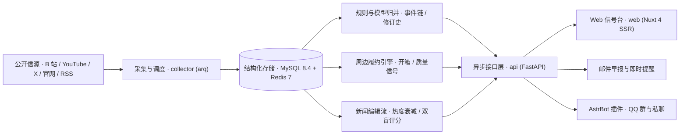

<div align="center">


# AniSignal

**让重要的变化，主动找到你。**

自托管的多分区情报与周边履约追踪信号台。<br>
汇集分散在官号、官网公告、视频与 RSS 里的公开动态，归并为有据可查的事件，按你的关注送达网页、邮件与 QQ。

<p>
<a href="https://github.com/tianyin231/AniSignal/actions/workflows/ci.yml"></a>
<a href="https://github.com/tianyin231/AniSignal/actions/workflows/docker-publish.yml"></a>
<a href="LICENSE"></a>


</p>

**[在线体验](https://anisignal.xyz/)** · [交互导览](https://anisignal.xyz/intro) · [快速开始](#快速开始) · [部署手册](docs/deployment.md) · [功能详解](docs/features.md) · [更新记录](https://anisignal.xyz/project) · [反馈问题](https://github.com/tianyin231/AniSignal/issues)

**简体中文** · [English](README.en.md)

</div>

<a href="https://anisignal.xyz/">
  <picture>
    <source media="(prefers-color-scheme: dark)" srcset="docs/assets/readme/home-dark.webp">
    
  </picture>
</a>

---

追踪一款游戏的版本前瞻、一件预售手办的出货实况，或是高频迭代的 AI 行业动态，往往意味着在 B 站、YouTube、官网公告、社区版面与十几路 RSS 之间来回切换——同一条消息被搬运号反复刷屏，真正关键的时间节点、补丁修订与首批玩家反馈却淹没在时间线里。

**AniSignal 不做制造「未读数焦虑」的瀑布流阅读器，而是把碎片动态整理成结构化的信号台：** 指向同一件事的多源内容自动收敛为一条事件并附带完整证据链；横跨数月的周边预售从开订一路跟进到实物开箱；行业快讯按独立编辑流去重评分、定时成刊。在给出精炼结论的同时，每一条信息都保留退回原始出处核对的入口。

## 核心体验

<table>
  <tr>
    <td width="50%" valign="top">
      
      <p><b>事件归并与证据链</b><br>当官号动态、官网公告、PV 视频与社区讨论指向同一件事，自动收敛为单一事件——完整保留首见时间、修订历史与多源原始链接，官方定论与社区传闻泾渭分明。</p>
    </td>
    <td width="50%" valign="top">
      
      <p><b>周边全周期履约追踪</b><br>从官方公告自动识别新开订周边并建档，持续追踪尾款、延期说明、首批实物开箱与做工反馈；严格区分「自购样本」与「官方送测」，确认大面积到货后自动结案停采。</p>
    </td>
  </tr>
  <tr>
    <td width="50%" valign="top">
      
      <p><b>结构化活动日历</b><br>自动从冗长的版本公告与活动帖中提取活动、卡池、维护与直播的起止时间，按分区聚合为月历与倒计时视图，一键即可加入个人日历。</p>
    </td>
    <td width="50%" valign="top">
      
      <p><b>为小屏重排的阅读体验</b><br>底部导航、触控热区与浅色 / 深色主题均针对手机端独立排版；无论从邮件早报还是群聊卡片点开链接，都能即开即读。</p>
    </td>
  </tr>
</table>

## 为自托管而设计

- **纯净空库起步，分区自由生长**：全新部署默认零演示数据启动。无需修改代码或重编镜像，即可在后台随时**新建任意自定义分区**（游戏、番剧、开源项目或垂直话题），也可按需一键导入内置的 15 套预设信源包，支持多选批量启停与清理。
- **渐进式依赖，无外部密钥亦可运行**：大模型与邮件服务均为*可选增强*而非启动前提。未配置 LLM 时，基于规则的事件归并与多平台采集照常运转，`/ai` 快讯页可一键切换「显示未审原文」直接阅读一手 RSS；未配置 SMTP 时，管理员可在后台查看待用注册验证码、一键激活账号或重置密码。
- **全程网页运维，告别 SSH 折腾**：B 站登录可选（不登录也能采关键词与 UP 主投稿），需要时可在网页后台扫码、账号密码、短信验证码或粘贴 Cookie 登录；OpenAI 兼容接口密钥池、分平台 HTTP/SOCKS 采集代理池、站点文案与合规信息均在管理台实时生效。每个信源独立记录健康度，连续失败自动退避。
- **三层关注粒度与多端主动送达**：除管理员维护的公共分区信源外，登录用户可配置站内**标题关键词关注**，或开辟独立的**定制监控**（B 站关键词 / UP 主、RSS / Atom、YouTube 频道，可选公开或私有，默认每人 3 个）；更新汇总后支持每日 08:00 邮件早报、重点消息即时提醒与 **QQ 群 / 私聊机器人**推送。

## 信源覆盖与预设矩阵

采集编排原生支持 **B 站**（官号动态、UP 主投稿、关键词搜索）、**YouTube**（默认免密钥频道 RSS，可选 Data API v3）、**米游社**、**游戏官网公告**、**标准 RSS / Atom** 与 **X（Twitter）公开账号**。

仓库内置 **14 个游戏分区**与 **AI 快讯**预设包（默认不自动写入，可在 `/admin/targets` 勾选按需导入），同时支持无限扩展自建分区：

| 分区类别 | 包含分区 | 预设信源构成 |
| :--- | :--- | :--- |
| **深度游戏预设** | 鸣潮 · 原神 · 明日方舟：终末地 | B 站官号（含周边号/米游社）、官网公告、YouTube 频道、社区视频搜索 |
| **多端游戏预设** | 崩坏：星穹铁道 · 明日方舟 · 碧蓝航线 · 胜利女神：NIKKE | B 站官号 / 官网公告、YouTube 频道、社区视频搜索 |
| **轻量游戏预设** | 绝区零 · 无限暖暖 · 星布谷地 · 崩坏：因缘精灵 · 洛克王国：世界 · 蓝色星原：旅谣 · 异环 | B 站官号动态与视频、社区精选搜索 |
| **行业资讯编辑流** | AI 快讯（`/ai`） | OpenAI / Anthropic / Google AI / DeepMind / Hugging Face 等一手 RSS、B 站搜索与可选 X 账号；支持 48h 主体热度衰减、双盲评分精选与每日 08:00 成刊 |
| **自定义分区** | 后台随时新建（自定义英文标识、名称、主题色与关键词别名） | 自由挂载任意平台的账号、频道、RSS 订阅或搜索词，支持手动标记「官方账号」身份 |

## 系统架构



生产环境采用职责清晰的 **5 容器编排**（`mysql`、`redis`、`api`、`web`、`collector`）：`api`、`web` 与 `collector` 共享同一份多架构镜像层，不重复占用磁盘，日志与扩缩容彼此独立（`collector` 内置基于 Redis 的分布式选主与任务互斥锁，可直接水平扩容）。本地开发则可退化为 **SQLite + 进程内队列**，零容器依赖直接启动。

## 快速开始

### 方式一：Docker Compose 部署（推荐）

需要 Git、Docker 24+ 与 Docker Compose v2，建议机器内存 **≥ 2 GB**。官方预构建镜像 `ghcr.io/tianyin231/anisignal` 原生提供 `linux/amd64` 与 `linux/arm64` 双架构，无需在服务器上编译前后端源码。

**1. 准备配置文件**

```bash
git clone https://github.com/tianyin231/AniSignal.git
cd AniSignal
cp .env.example .env
```

编辑 `.env` 中的核心配置：

| 变量名 | 必填 | 说明与建议值 |
| :--- | :---: | :--- |
| `MYSQL_ROOT_PASSWORD` | 是 | 数据库密码（建议用 `openssl rand -hex 24` 生成随机串） |
| `ANISIGNAL_ADMIN_TOKEN` | 是 | `/admin` 初始引导令牌（请替换为随机长字符串，切勿保留 `change-me`） |
| `ANISIGNAL_PUBLIC_BASE_URL` | 推荐 | 对外完整访问基址（本机试用保持 `http://127.0.0.1:8090`；正式上线填 `https://你的域名`） |
| `WEB_PORT` | 否 | 宿主机监听地址（默认 `127.0.0.1:8090` 供反代转发；局域网直连可改为 `0.0.0.0:8090`） |

**2. 一键拉起服务**

```bash
docker compose up -d
docker compose ps
```

**3. 浏览器内完成 3 步初始化**

访问 **`http://127.0.0.1:8090/admin`** 输入 `ANISIGNAL_ADMIN_TOKEN`（首次登录时可勾选将当前个人站点账号绑定为管理员，后续点击顶栏头像菜单「管理看板」即可免口令直进）：

1. **选定分区与信源（`/admin/targets`）**：全新安装时只有 AI 分区是启用的，其余内置分区先隐藏，导入对应预设或手动启用后才出现在前台导航；可新建自定义分区或启停内置分区，点击「导入预设信源」一键勾选所需预设包；B 站登录是可选的，如需提高 B 站动态抓取成功率，可在同页扫码登录（或在「更多登录方式」里用账号密码、短信、Cookie）。
2. **接入 AI 模型（可选，`/admin/ai`）**：填入任意 OpenAI 兼容接口（Base URL、Key 池与模型名），开启事件摘要、日历抽取、周边建档与快讯精炼。
3. **配置邮件与站点信息（可选，`/admin/settings` & `/admin/users`）**：配置 SMTP 开启每日早报与自助找回密码，或直接在 `/admin/users` 管理注册码与用户激活。

> **常见环境提示**：若 `.env` 密码中包含 `$` 或 `#`，请用单引号 `'...'` 包裹以防被 Compose 截断；宿主机开启 Clash / mihomo TUN `fake-ip` 模式时，在 `.env` 中添加 `ANISIGNAL_EGRESS_ALLOW_CIDRS=198.18.0.0/15` 即可放行虚拟网段。Nginx 反代模板、SELinux / macOS 挂载说明与备份升级流程详见[部署与运维手册](docs/deployment.md)。

### 方式二：本地源码开发（免 Docker / MySQL / Redis）

需要 **Python 3.12+（uv）** 与 **Node.js 22（npm）**：

```bash
# 终端 1：启动后端（自动使用 SQLite ./server/local.db 与进程内队列，默认管理令牌 local-dev）
cd server
uv run python -m app.local

# 终端 2：启动前端开发服（http://localhost:3000）
cd web
npm ci
npm run dev
```

## 接入 QQ 机器人（AstrBot）

配套插件源码位于 [`integrations/astrbot_plugin_anisignal`](integrations/astrbot_plugin_anisignal)，同步发布于独立仓库 [AstrBot_Plugin_AniSignal](https://github.com/tianyin231/AstrBot_Plugin_AniSignal)，支持 QQ 官方机器人与 OneBot v11（NapCat 等）：

1. 在 AstrBot 管理面板打开 **「插件管理 → 从链接安装」**，填入 `https://github.com/tianyin231/AstrBot_Plugin_AniSignal`；
2. 在插件配置中填写 AniSignal 实例地址与机器人授权密钥；
3. 在群聊或私聊发送 `/情报订阅` 或 `/帮助`，即可按群定制接收分区、早报图文卡片、即时快讯与关键词查询。

详细指令与渲染效果见[插件说明文档](integrations/astrbot_plugin_anisignal/README.md)。

## 文档导航

| 文档 | 内容概览 |
| :--- | :--- |
| [部署与运维手册](docs/deployment.md) | Docker Compose 详解、Nginx HTTPS 反代模板、国内网络与代理池、数据备份与故障自救 |
| [功能与机制指南](docs/features.md) | 三种关注方式边界、规则事件归并、AI 快讯热度/评分算法与周边履约判定逻辑 |
| [后端架构说明](server/README.md) | FastAPI 目录分层、Alembic 迁移规范、采集器适配器接口与单元测试 |
| [前端架构说明](web/README.md) | Nuxt 4 SSR 目录结构、Signal Desk 视觉设计令牌与组件约定 |
| [参与贡献](CONTRIBUTING.md) · [安全策略](SECURITY.md) | 本地提交流程、代码与隐私规范、安全漏洞私密通报渠道 |

## 许可证

Copyright © 2026 tianyin231 与贡献者。本项目基于 [GNU AGPL-3.0](LICENSE) 开源发布：你可以自由使用、修改与分发本软件；若将修改后的版本通过网络向他人提供服务，须同样以 AGPL-3.0 公开完整源代码（可在后台 `/admin/settings` 配置站点底部的源码仓库链接与联系邮箱）。

## 致谢

本项目由人类开发者与多款大语言模型结对迭代构建，感谢开源社区与以下模型及工具链的支持。

<details>
<summary>展开查看协同模型与开发工具</summary>

| 研发机构 | 协同模型 |
| :--- | :--- |
| **Anthropic** | `Claude Opus 5.5` |
| **OpenAI** | `GPT-6.1 Sol` · `GPT-6 Astra` · `GPT-5.6 Sol` |
| **Google DeepMind** | `Gemini 4 Carbon` · `Gemini 3.8 Flash` |
| **xAI** | `Grok 4.7` |
| **StepFun** | `Step 5 Preview` |
| **Zhipu AI** | `GLM-5.3` · `GLM-5.3 Flash` |
| **Xiaomi** | `MiMo v2.6 Pro` |
| **Agnes AI** | `agnes-3.0-flash` · `agnes-2.0-flash` |

开发工具与 Agent 宿主：`ChatGPT(codex)` · `Claude Code` · `ZCode` · `Antigravity` · `Ponytail` · `GrokBot` · `Muse` · `GPTDots`

</details>

<div align="center">

<a href="https://github.com/tianyin231/AniSignal/graphs/contributors"></a>

<a href="https://star-history.com/#tianyin231/AniSignal&Date">
  <picture>
    <source media="(prefers-color-scheme: dark)" srcset="https://api.star-history.com/svg?repos=tianyin231/AniSignal&type=Date&theme=dark">
    
  </picture>
</a>

</div>
