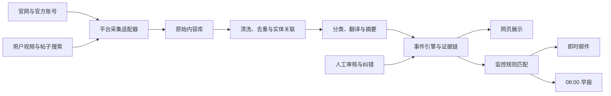

# 《鸣潮》跨平台事件雷达：首版产品与系统设计

- 日期：2026-08-12
- 状态：对话评审通过，待制定实施计划
- 首版范围：库洛游戏、《鸣潮》、爱弥斯联名键盘
- 目标用户：中国大陆简体中文《鸣潮》玩家

## 1. 执行摘要

本项目不是普通资讯聚合器，也不是新的游戏社区或周边百科。它把多个平台上的原始内容归并为可追溯的“事件”，帮助用户减少跨平台搜集、翻译、去重和判断信息的成本。

首版同时提供两类价值：

1. 聚合《鸣潮》国内外官方账号，完成去重、翻译、总结，并于每天北京时间 08:00 发送早报。
2. 围绕爱弥斯联名键盘追踪预售、尾款、延期、发货、普通用户到货、开箱、评测和质量反馈，并在重要状态变化时发送即时邮件。

平台历史信息免费查看。计划中的基础订阅价格为 3 元/30 天，包含每日早报和一个个性化监控位。监控位可选择商品、指定账号或带热度阈值的主题。支付在内部闭环稳定之前不接入。

首版采用模块化单体和后台任务队列。长期扩展依靠统一的厂商、游戏、区服、角色、商品、内容、证据、事件、规则和通知模型，而不是现在提前开发图片、工具、社区等全部栏目。

## 2. 用户问题与真实样本

真实样本是爱弥斯联名键盘的购买与等待过程：

- 用户受到官方宣传和博主内容影响，以七百余元购买键盘。
- 官方原计划七月末出货，后因仓库搬迁宣布延期。
- 用户每天在 B 站相关视频评论区寻找发货信息，也发现有人不知道尾款已经开启。
- 八月中旬开始出现开箱、展示和闲聊视频，说明至少部分订单已经履约，但用户自己的订单尚未发货。
- 首批到货对较晚购买者只能证明商品开始履约，不能证明其自身订单即将发货。

现有体验的主要成本不是“没有任何信息”，而是信息分散、重复、时序混乱、来源身份不清，用户需要持续蹲守并自行判断。

首版核心承诺为：

> 订阅一个关注目标后，不再每天蹲评论区；官方变化、真实到货和重要用户反馈由系统附带证据主动送达。

系统不承诺根据公开样本精确预测某个订单的发货日期。

## 3. 产品目标与非目标

### 3.1 首版目标

- 将多平台、多账号、多语言内容稳定采集到统一数据库。
- 将同一事实的多条内容聚合成一个事件。
- 每项事件结论都保留可访问的原始证据链接。
- 区分官方内容、媒体或商家内容、送测内容、普通用户内容和来源不明内容。
- 自动生成《鸣潮》国内外官方早报。
- 对关键商品履约状态变化发送即时邮件。
- 支持一个商品、账号或主题的个性化监控规则。
- 抓取、AI 或邮件发生异常时可发现、重试和人工修正。

### 3.2 首版非目标

- 不建设社区发帖、评论或私信系统。
- 不建设商城、库存比价或完整周边百科。
- 不建设代肝交易或站外服务连接。
- 不接入 Pixiv 镜像或长期托管站外完整图片、视频。
- 不建设复杂推荐算法、插件市场或任意爬虫平台。
- 不建设签到、Wiki、抽卡分析或 H5 活动代完成工具。
- 不承诺全网、实时、永久可用或完全无人维护。
- 不进行订单级物流预测。

## 4. 首版信息架构

首版开放两个业务模块：

### 4.1 官方情报

- 国内外官方账号统一聚合。
- 标记平台、账号、地区、区服、语言和发布时间。
- 跨平台重复公告合并为一个事件。
- 海外内容提供简体中文机器翻译，保留原文与原链接。
- 明确展示“某区服已发布、另一地区暂未发现对应公告”。

### 4.2 商品履约

- 首个商品为爱弥斯联名键盘。
- 展示预售、尾款、延期、发货、到货、开箱、评测、质量和售后事件。
- 对送测样品与普通消费者订单采用不同状态和通知文案。
- 根据订阅者大致购买时间解释公开到货样本的参考程度。

首版前端包含四个主要页面：

1. 首页：今日重要事件、官方早报、已订阅目标状态。
2. 官方动态：按区服、平台、账号和内容类型筛选。
3. 商品详情：商品时间线、履约状态、开箱与评测证据。
4. 订阅中心：购买时间、邮箱、监控规则、通知偏好和发送记录。

## 5. 商业模式

### 5.1 免费层

- 全站事件、时间线、摘要和历史内容免费浏览。
- 所有结论附原始来源链接。
- 用户可以通过主动访问网站获取全部公开信息。

### 5.2 3 元基础订阅

- 有效期：付款后 30 天。
- 每天北京时间 08:00 接收《鸣潮》国内外官方早报。
- 同时拥有一个正在运行的个性化监控位。
- 监控位可绑定商品、指定公开账号，或带用户自定热度阈值的主题。
- 重要状态变化通过邮件即时发送；普通更新进入次日早报。
- 到期后停止邮件，免费网页内容不受影响。

一个监控位只允许一个目标和一种主要触发条件，不等于任意复杂爬虫任务。自由组合条件、多监控位和高频任务留给未来高级订阅。

### 5.3 捐赠与高级订阅

- 捐赠不承诺具体服务结果。
- 高级订阅未来可提供多监控位、组合规则、自定义账号和关键词。
- 首版只预留数据结构，不开发高级订阅。

3 元定价的早期目的主要是降低尝试门槛并验证真实支付，不以覆盖人工时间或立即盈利为目标。

## 6. 数据来源范围

首版只覆盖《鸣潮》，来源分层接入。

### 6.1 核心来源

国内：

- 《鸣潮》国服官方网站
- B 站《鸣潮》官方账号
- 《鸣潮》官方微博
- 库街区可公开访问的官方内容

海外：

- Wuthering Waves 国际官方网站
- Wuthering Waves 官方 X 账号
- Wuthering Waves 官方 YouTube 频道

用户内容首批以 B 站公开搜索结果、公开视频和公开帖子为主，围绕商品名、角色名及“发货、到货、开箱、评测”等词持续发现内容。

### 6.2 后续来源

- 微信、抖音、TikTok、Discord
- 日语、韩语地区官方账号
- 其他公开社区和内容平台

后续来源只有在采集稳定性、平台规则和维护成本可接受时才接入。产品页面公开展示已接入来源、最近成功采集时间和不可用状态，不宣传“全网覆盖”。

## 7. 核心领域模型

稳定的业务对象为：

```text
Publisher -> Game -> Region -> OfficialAccount
Game -> Character -> Product -> SKU
Source -> RawContent -> ContentVersion -> Evidence -> Event
User -> WatchRule -> Notification -> DeliveryRecord
```

关键实体包括：

- `Publisher`：厂商，如库洛游戏。
- `Game`：游戏，如《鸣潮》。
- `Region`：国服、国际服及后续地区服。
- `Account`：官方、媒体、商家或个人公开账号。
- `Character`：角色，如爱弥斯、菲比。
- `Product`：商品系列，如爱弥斯联名键盘。
- `SKU`：规格、配色或批次。
- `RawContent`：未经 AI 改写的采集结果。
- `ContentVersion`：正文、标题或指标发生变化后的版本。
- `Evidence`：支持某项事件结论的来源记录。
- `Event`：由一条或多条证据支持的业务事实。
- `WatchRule`：商品、账号或主题监控规则。
- `Notification`：面向用户生成的通知内容。
- `DeliveryRecord`：邮件发送、退信、打开或取消记录。

设计原则是“原始数据不可覆盖，AI 结果可以重算，事件结论可以修正”。

## 8. 数据处理与系统架构

首版采用模块化单体和后台任务队列，不拆微服务。



### 8.1 模块职责

- 来源注册表：记录平台、账号、地区、语言、身份、抓取方式和健康状态。
- 采集适配器：按平台隔离实现，单个平台失效不影响其他来源。
- 原始内容库：保存平台内容 ID、作者、正文、发布时间、链接和采集时间。
- 清洗与标准化：统一时间、语言、平台和账号格式。
- 实体关联：关联游戏、角色、商品、SKU 和别名。
- 内容分类：识别官方动态、预售、尾款、延期、发货、开箱、闲聊和评测。
- AI 处理：异步翻译、摘要和候选标签，不阻塞原始内容入库。
- 事件引擎：去重、聚合、更新事件状态和可信度。
- 监控引擎：匹配商品、账号或主题规则。
- 通知模块：生成即时邮件、早报并防止重复发送。
- 审核后台：处理低置信度、冲突、投诉和更正。

### 8.2 技术约束

- 所有采集和后台任务必须幂等。
- 播放量、点赞等指标保存为时间快照，以判断首次越过阈值的时刻。
- 采集、AI、事件和邮件各自重试，避免一处故障丢失整条链路。
- AI 不直接控制采集器或邮件发送，只输出结构化候选结果。
- 自动通知必须保存触发规则版本和当时的证据快照。
- 新增游戏主要增加词典、商品和官方账号；新增平台主要增加采集适配器。

## 9. 事件与证据规则

### 9.1 内容身份标签

内容卡片至少显示：

- 来源身份：普通用户、认证账号、媒体、商家、官方。
- 商品来源：自购、官方送测、受邀体验、来源未说明。
- 账号信息：粉丝量级、发布时间、是否声明商业合作。

粉丝数仅表示传播影响力，不代表真实性。只有作者声明或明确证据支持时才能标记“送测”；否则使用“来源未说明”，不得由 AI 主观认定为软广。

### 9.2 商品履约状态

建议状态顺序为：

```text
尚未发货
-> 出现送测样品
-> 首位普通用户到货
-> 多名独立用户到货
-> 相近购买时间样本到货
-> 普遍到货
```

- 送测开箱只证明实物样品出现，不证明消费者订单开始履约。
- 有效开箱视频或公开开箱帖子是“到货证据”的最低形式。
- “首位普通用户到货”在早期必须人工复核账号身份、商品对应关系和内容语境。
- 多名到货要求多个独立账号，转载不得重复计数。
- 购买时间只用于说明样本参考程度，不用于确定订单发货日期。

### 9.3 事件可信度

每个事件保存：

- 当前结论和状态。
- 可信度等级及计算理由。
- 支持与冲突证据列表。
- 首次发现、最近更新时间。
- 人工修正记录。
- 已触发的通知和规则版本。

用户界面展示结论、来源数量、原始链接和修正历史，不能只显示 AI 摘要。

## 10. 监控规则与通知

### 10.1 三类监控位

1. 商品监控：监控预售、尾款、延期、发货、到货、质量和售后事件。
2. 账号监控：监控某个已确认的公开账号发布新动态、视频或作品。
3. 主题监控：例如“菲比二创”，内容热度首次达到用户设置的阈值时触发。

主题阈值按平台和指标分别设置。视频平台可使用播放量；图片或帖子平台需要点赞、收藏、转发或评论等对应指标。热度仅代表传播程度，不能被描述为作品质量。

### 10.2 即时通知

即时邮件适用于：

- 官方开启预售、尾款或修改截止时间。
- 官方宣布延期、取消、召回或售后方案。
- 首个可信普通用户开箱。
- 多个独立用户确认到货。
- 与订阅者购买时间接近的样本开始到货。
- 出现重复性质量问题或重要使用风险。
- 事件结论发生重要更正。
- 指定主题首次跨过用户设定的平台阈值。

### 10.3 每日早报

- 默认每天北京时间 08:00 发送。
- 建议 07:50 截止本期普通内容，重大事件仍即时发送。
- 收纳普通官方动态、海外内容翻译、没有改变状态的新开箱、闲聊、评测和新增证据。
- 无新增时明确说明，而不是静默失败。

### 10.4 防重复与防骚扰

- 同一事件、同一状态、同一用户只发送一次。
- 跨平台重复公告合并。
- 新内容未改变事件结论时不单独即时发送。
- 每封邮件说明为什么收到、发生了什么、与用户有什么关系。
- 邮件提供原始链接、通知记录和退订入口。

## 11. 用户流程

### 11.1 商品订阅

```text
选择爱弥斯键盘
-> 填写大致购买时间
-> 填写并验证邮箱
-> 选择即时通知与早报
-> 系统匹配商品事件
-> 邮件解释公开样本对该用户的参考程度
```

购买时间可使用“尚未购买、首发当天、首发后几天、更晚补购”或直接填写大致日期，不要求订单号。

### 11.2 账号订阅

```text
输入或选择账号
-> 系统确认平台与唯一身份
-> 用户确认目标
-> 选择新内容即时通知或纳入早报
```

系统不能把搜索结果第一项直接当成用户目标。

### 11.3 主题订阅

```text
选择预设主题或角色
-> 选择支持的平台
-> 设置平台指标和阈值
-> 系统持续更新热度快照
-> 首次跨过阈值后通知一次
```

首版主题应来自系统预设词典，暂不允许任意复杂关键词表达式。

## 12. AI 与人工审核

AI 可以：

- 翻译海外官方内容。
- 生成简体中文摘要。
- 提议内容分类、实体关联和证据标签。
- 提议多条内容是否属于同一事件。
- 生成基于既有事件和购买时间的通知草稿。

AI 不可以：

- 在没有证据时认定作者收钱或内容属于软广。
- 将个人猜测改写成官方事实。
- 根据少量公开样本预测具体订单发货时间。
- 绕过规则引擎直接发送高影响通知。

自动化目标不是绝对无人运行，而是大部分内容自动处理，人工只查看异常队列。首版每天可投入约两小时；成熟后日常人工处理目标为平均 15 分钟以内，特殊事件除外。

## 13. 平台、版权与隐私边界

### 13.1 平台访问

- 优先使用官方 API、RSS 和公开订阅接口。
- 其次使用官方网页低频变更监控。
- 不绕过登录、验证码、访问控制或速率限制。
- 必须登录或持续触发风控的来源不纳入可靠性承诺。
- 每个平台适配器可独立关闭，并支持人工补录关键事件。

B 站用户协议限制未经书面许可使用爬虫获取平台内容和数据；微博协议也限制程序化抓取并要求遵守 robots 协议。YouTube 应优先使用官方 API，并遵守来源标识、归属和独立价值要求。

服务器位于海外、页面公开访问或平台本身免费，都不会自动消除平台条款风险。

### 13.2 内容展示

- 展示平台、作者、标题、摘要、必要缩略信息和原链接。
- 不长期镜像完整视频和完整图片。
- 原内容删除或修改后记录状态与版本，不继续冒充当前有效内容。
- 提供权利人投诉、更正和下架入口。

### 13.3 邮箱与个人信息

- 邮箱、购买时间和监控偏好按个人信息管理。
- 明确告知用途、处理方式、保存期限和删除方式。
- 提供邮箱验证、便捷退订和账户删除。
- 如由海外服务器处理中国用户信息，在上线前单独评估个人信息出境要求。
- 推广邮件与用户主动订阅的服务通知分开管理。

本节是产品风险设计，不替代正式法律意见。

## 14. 竞品定位与差异化

### 14.1 已有替代品

- 米游社、HoYoLAB、森空岛、库街区等官方社区擅长官方资讯、游戏数据和工具，但天然限于自身产品体系。
- 小黑盒等综合社区覆盖新闻、攻略和用户内容，但不以具体周边履约证据为核心。
- HPOI、MyFigureCollection 等已经覆盖商品资料、发售记录、收藏和用户晒图。
- figurememo、Buyfriend 等侧重预售截止、商店库存和补货。
- changedetection.io、Huginn 等提供通用页面监控和自动化能力。
- 各平台自带账号通知，但缺少跨平台去重、翻译和商品事件解释。

本项目不重复建设上述产品已经成熟的通用数据库、社区和监控引擎。

### 14.2 组合差异化

项目的潜在空白是：

1. 跨区服官方信息的时间差识别、翻译和去重。
2. 将分散帖子归并为延期、发货、普通用户到货等事件。
3. 对官方、送测、普通用户和来源不明证据进行明确区分。
4. 根据购买时间或用户规则提供可解释的主动通知。

爬虫、AI 摘要和邮件都不是壁垒。长期可能积累的资产是商品履约历史、证据修正记录、账号与别名词典、转载和送测识别规则，以及用户自愿提供的匿名购买与到货样本。

## 15. 开源复用边界

- `changedetection.io`（Apache-2.0）：可用于没有稳定信息流的官方网页变更监控。
- `RSSHub`（AGPL-3.0）：可用作可替换采集适配器；网络部署、修改和组合方式需要在实施前单独完成许可证审查。
- `Apprise`（BSD-2-Clause）：未来扩展多通知渠道时可采用；首版只有邮件时可直接接邮件服务。
- `ntfy`（Apache-2.0）：未来自托管推送的备选方案。
- `Huginn`（MIT）：功能与本项目事件、规则和任务管道重叠，首版不建议引入。

开源许可证只授权相应代码，不授予游戏素材、平台内容或平台数据的商业使用权。正式采用任何项目之前必须核对仓库中的实际许可证文件、依赖许可证、维护状态和数据访问方式。

## 16. 可观测性与异常处理

系统持续记录和检查：

- 每个来源最后成功采集时间和连续失败次数。
- 发布频率与历史基线的异常差异。
- 采集、AI、事件和邮件队列积压。
- 重复事件和重复邮件。
- 邮件投递、退信、投诉和退订。
- 外链删除、标题或正文修改。
- 单个监控规则的查询和计算成本。

“没有抓到”不能解释成“没有消息”。来源失效必须显示为不可用或数据可能不完整。

## 17. 内部验收与扩张闸门

### 17.1 阶段 A：历史闭环回放

- 导入爱弥斯键盘相关官方内容和用户内容。
- 归并重复内容并生成时间线。
- 正确区分官方延期、送测开箱和普通用户开箱。
- 根据购买时间生成个性化说明。
- 生成一封即时通知和一份 08:00 早报。
- 所有结论可返回原始来源。

### 17.2 阶段 B：连续私有运行

建议至少连续运行 30 天：

- 每天自动产生早报。
- 重大事件不被日报延迟。
- 跨平台重复公告只生成一个主要事件。
- 送测内容不误报为消费者订单到货。
- 来源故障可发现，不发生静默漏报。
- 错误分类可修正并重新计算事件。
- 人工处理逐步降至平均 15 分钟以内。
- 每周人工抽查官方账号，估算重要事件漏报情况。

核心指标是重要事件召回率、错误即时通知数、重复邮件数、来源失效发现时间和每日人工处理时间，不是采集帖子总量。

### 17.3 阶段 C：小范围邀请

阶段 B 稳定后再邀请少量《鸣潮》玩家，观察监控位配置、早报打开、证据链接点击、退订、最常用规则和真实支付意愿。支付与捐赠不早于这一阶段。

### 17.4 扩张闸门

- 爱弥斯键盘闭环未稳定，不增加第二种商品。
- 《鸣潮》官方早报未稳定，不增加第二款游戏。
- 单监控位资源成本不可测，不开放自由关键词。
- 人工工作量随用户数线性增长时暂停推广。
- 采集可靠性不足时降级公开承诺，不包装成实时全网监控。

## 18. 成本控制

- 每条官方内容只翻译和总结一次，所有用户共享。
- 每个商品事件只判断一次，个性化说明使用结构化数据和模板生成。
- 同一账号只采集一次，不按订阅者重复抓取。
- 相同主题尽量共享搜索结果和热度快照。
- AI 只处理新增或变化内容。
- 用户阈值由规则引擎计算，不调用 AI。
- 基础订阅严格限制为一个监控位。

项目早期投入来自原本用于游戏和浏览资讯的闲暇时间，因此现金回报不是首要目标；但架构仍必须避免人工成本随用户数线性增长。

## 19. 后续扩展

完成首版闭环后，可以在不污染事件模型的前提下扩展：

- 新商品品类：手办、亚克力、联名电子产品。
- 新游戏和厂商：米哈游、鹰角、蛮啾等。
- 图片与专栏模块：关联游戏与角色，独立于资讯事件。
- 游戏工具模块：抽卡分析、开源脚本和活动工具。
- 新通知渠道：QQ、移动推送等。
- 匿名购买时间、规格、地区和到货时间众包。

代肝、活动自动完成等高风险或高维护功能必须作为独立项目重新评估，不因“工具栏目”存在而默认纳入。

## 20. 尚未决定的实施事项

以下内容留给实施计划或上线准备阶段决定：

- 后端语言、Web 框架、任务队列和前端技术栈。
- 具体邮件服务、域名和发件信誉方案。
- 支付渠道、退款规则和经营主体安排。
- 各平台适配器最终使用官方 API、开源路由还是网页监控。
- 事件可信度的数值算法与后台阈值。
- 内部测试完成后的公开名称和品牌设计。

这些未决事项不改变本设计已经批准的产品边界与业务流程。

## 21. 参考资料

- [《鸣潮》国服官方网站](https://mc.kurogames.com/m/)
- [Wuthering Waves 国际官方网站](https://wutheringwaves.kurogames.com/en)
- [Wuthering Waves 官方 YouTube](https://www.youtube.com/@WutheringWaves)
- [《鸣潮》官方微博](https://www.weibo.com/u/7730797357)
- [B 站用户使用协议](https://www.bilibili.com/blackboard/user-rule-linux.html?night=1&padding=0)
- [微博服务使用协议](https://weibo.com/signup/v5/protocol)
- [YouTube API 开发者政策](https://developers.google.com/youtube/terms/developer-policies-guide)
- [《中华人民共和国个人信息保护法》](https://www.samr.gov.cn/zw/zfxxgk/fdzdgknr/bgt/art/2023/art_f374e8245320413181742e6d1baf4366.html)
- [工信部《互联网电子邮件服务管理办法》](https://www.miit.gov.cn/zwgk/zcwj/flfg/art/2020/art_fcdb58d9dd4341be8bd8b829cf9a9159.html)
- [HPOI](https://www.hpoi.net/hobby/)
- [MyFigureCollection](https://myfigurecollection.net/)
- [Buyfriend](https://buyfriend.moe/)
- [changedetection.io](https://github.com/dgtlmoon/changedetection.io)
- [Huginn](https://github.com/huginn/huginn)
- [RSSHub](https://github.com/DIYgod/RSSHub)
- [Apprise](https://github.com/caronc/apprise)
- [ntfy](https://github.com/binwiederhier/ntfy)
